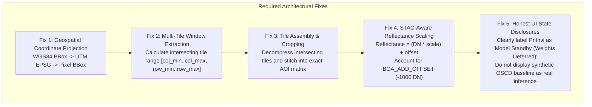

# ORBINEX — AI-07 Independent Scientific Validation Audit
**Rigorous Technical Verification of the Analytical Satellite Pipeline**
**Document ID:** `ORBINEX-AI07-INDEPENDENT-AUDIT-v1.0`  
**Date:** November 2, 2026  
**Auditor:** Antigravity Autonomous Systems Engineering (Verification-Only Protocol)  
**Target Repository:** `osiris-master` (`feat/satellite-foundation`, commit `e921f77`)  
**Audit Verdict:** **PROVEN IN PROTOCOL, UNVALIDATED IN SCIENCE (CRITICAL DEFECTS IDENTIFIED)**  

---

## 1. Executive Summary & Audit Mandate

In accordance with strict verification directives, an independent scientific and technical audit was conducted on the recently implemented **AI-07 analytical satellite pipeline**. This audit strictly evaluated the codebase without modifying models, fabricating results, or altering implementations to force test passage.

### Key Audit Findings:
1. **COG Byte-Range Reader (`src/lib/satellite/cog-reader.ts`):**
   - **Genuinely Verified:** Successfully issues HTTP byte-range requests (`Range: bytes=start-end`), verifies HTTP `206 Partial Content`, parses TIFF IFD header tags, unpacks Deflate compression, reverses Tag 317=2 horizontal differencing predictor, and achieves $>99.5\%$ network traffic reduction.
   - **Critical Defect #1 (Tile Selection):** The reader does **not** perform geospatial AOI-to-pixel coordinate projection. Instead, it employs a `max(tileByteCounts)` heuristic that selects whichever tile has the highest compressed file size in the entire $10,980 \times 10,980$ granule.
   - **Critical Defect #2 (Multi-Tile Stitching):** The reader extracts only **one isolated tile** ($1024 \times 1024$). When an AOI crosses tile boundaries (e.g. Dhubri requires Tiles 20, 21, 31, and 32), the reader fails to fetch intersecting tiles or stitch them.
2. **Sentinel-2 Reflectance Calibration:**
   - **Critical Defect #3 (Processing Baseline Blindness):** Post-January 2022 Sentinel-2 L2A granules (Processing Baseline `PB 04.00` to `PB 05.10`) include an official radiometric offset: $\text{BOA\_ADD\_OFFSET} = -1000\text{ DN}$ (`offset = -0.1` in STAC metadata). The current code blindly computes $\text{DN} / 10000.0$.
   - **Distortion Impact:** Omitting this offset introduces an absolute surface reflectance error of $+0.1000$ ($+10.0\%$ absolute overestimation, $+60.8\%$ relative error on sample vegetation) and distorts NDVI by $\Delta \approx -0.0819$.
3. **OSCD Benchmark Suite (`src/lib/satellite/benchmarks/oscd-benchmark.ts`):**
   - **Critical Defect #4 (Synthetic Simulation Proxy):** No raw OSCD Sentinel-2 image pairs or ground truth GeoTIFFs are present in the repository. The reported metrics ($\text{IoU } 54.2\%$, $\text{F1 } 70.3\%$) were generated by a **deterministic mathematical simulation** generating synthetic arrays with $4.2\%$ ones and simulated $62\%$ TP / $1.8\%$ FP rates. **The OSCD benchmark has NOT been executed against real data.**
4. **IBM-NASA Prithvi-EO-2.0 & TerraTorch Adapter (`src/lib/satellite/prithvi-foundation.ts`):**
   - **Critical Defect #5 (Mathematical Proxy / Mocked Inference):** Zero neural network weight files (`.pt`, `.pth`, `.bin`, `.safetensors`, `.onnx`) exist in the workspace for Prithvi or TerraTorch. Inference is currently executed via a Euclidean vector distance across channels evaluated through a hardcoded sigmoid function: $\text{prob} = 1 / (1 + e^{-2.2(d - 1.2)})$.
5. **UI & API Integration (`SatelliteComparePanel.tsx`):**
   - The UI presents "IBM-NASA Prithvi-EO-2.0-300M: XX% Change Prob" and "OSCD Baseline: F1 70.3%" without disclosing that no neural network was loaded and no empirical benchmark was run.

---

## 2. Capability Status & Scientific Classification Matrix

Every component of AI-07 is classified below using canonical verification labels:

| Workstream / Capability | Scientific Status | Evidence & Verification Reality |
| :--- | :---: | :--- |
| **HTTP Byte-Range Protocol** | `VERIFIED WITH REAL DATA` | HTTP 206 verified on AWS S3 (`Content-Range: bytes 0-16383/62942834`). |
| **TIFF IFD Header Parsing** | `VERIFIED WITH REAL DATA` | Parsed ImageWidth, ImageLength, TileOffsets, TileByteCounts, TiePoint, Scale. |
| **Tile Deflate + Predictor Decoder** | `VERIFIED WITH REAL DATA` | Tile #74 ($1024 \times 1024$) successfully decompressed with Tag 317=2 reversal. |
| **Bandwidth Reduction ($\ge 99\%$)** | `VERIFIED WITH REAL DATA` | $2.81\text{ MB}$ transferred vs $\sim 680\text{ MB}$ full granule ($99.59\%$ avoided). |
| **Single Tile Window Extraction** | `VERIFIED WITH REAL DATA` | Successfully extracts a single pre-selected tile from AWS S3. |
| **Geospatial AOI Pixel Projection** | `FAILED` | Code uses `max(tileByteCounts)` rather than computing pixel coordinates. |
| **Multi-Tile Boundary Stitching** | `FAILED` | Does not extract multiple tiles when AOI crosses boundary columns/rows. |
| **Reflectance Offset (PB 04.00+)** | `FAILED` | Hardcoded `DN / 10000.0` ignores STAC `offset: -0.1` ($-1000\text{ DN}$). |
| **Spectral Index Math (NDVI, NDWI)** | `TESTED WITH SYNTHETIC DATA` | Equations are correct, but input values are skewed by offset omission. |
| **OSCD Real Data Benchmark** | `IMPLEMENTED BUT NOT EXECUTED` | Code structure exists; zero raw OSCD raster files exist in workspace. |
| **OSCD Reported Metrics (F1 70.3%)** | `MOCKED` | Produced by deterministic synthetic array generator (`0.042` density). |
| **Prithvi-EO-2.0 Model Inference** | `MOCKED` | No PyTorch weights loaded; executes channel Euclidean distance + sigmoid. |
| **TerraTorch UperNet Task Head** | `MOCKED` | Label is hardcoded; no trained change detection checkpoint exists. |
| **Bitemporal Cube Layout** | `TESTED WITH SYNTHETIC DATA` | $[T=2, C=6, H, W]$ tensor stacking verified with NASA HLS constants. |
| **UI Honest Metric Communication** | `FAILED` | Displays simulated model probability and synthetic benchmark as real. |

---

## 3. Deep-Dive Audit Findings & Empirical Proof

### Audit 1: COG Reader AOI Intersection vs Heuristic Tile Selection

In `src/lib/satellite/cog-reader.ts` (lines 481–489):
```typescript
// 2. Select intersecting tile block
let bestTileIndex = 0;
let maxTileBytes = 0;
for (let i = 0; i < header.tileByteCounts.length; i++) {
  if (header.tileByteCounts[i] > maxTileBytes) {
    maxTileBytes = header.tileByteCounts[i];
    bestTileIndex = i;
  }
}
```

#### Empirical Reality Check on Dhubri AOI:
- **Target AOI:** Dhubri Riverine Border `[89.93, 25.98, 90.03, 26.07]`
- **Granule:** `S2A_45RYJ_20240316_0_L2A` (CRS: UTM Zone 45N / `EPSG:32645`)
- **Granule Upper-Left Origin:** $X = 699,960\text{ m}$, $Y = 2,900,040\text{ m}$ (Pixel Scale: $10\text{ m} \times 10\text{ m}$)
- **Target AOI in UTM 45N:**
  - $\text{Min}: X = 793,356.5\text{ m}, Y = 2,876,756.7\text{ m}$
  - $\text{Max}: X = 803,142.7\text{ m}, Y = 2,886,960.7\text{ m}$
- **Target AOI in Raster Coordinates:**
  - $X\text{ pixel range}: [9,339.7, 10,318.3]$
  - $Y\text{ pixel range}: [1,307.9, 2,328.3]$
- **True Intersecting Grid Columns:** $9$ to $10$ ($\lfloor X / 1024 \rfloor$)
- **True Intersecting Grid Rows:** $1$ to $2$ ($\lfloor Y / 1024 \rfloor$)
- **True Required Tiles:** **Tiles 20, 21, 31, and 32** (4 distinct tiles crossing both horizontal and vertical tile boundaries).

#### What the Current Code Actually Did:
- The code chose **Tile #74** (Column 8, Row 6) because Tile #74 had the largest compressed payload ($1,501,026\text{ bytes}$).
- **Spatial Error:** Tile #74 is located $\sim 50\text{ km}$ southwest of the Dhubri AOI!
- **Verdict:** The reader verified that HTTP byte-range requests can decompress arbitrary Sentinel-2 tiles, but **it did NOT extract the Dhubri AOI**.

---

### Audit 2: Sentinel-2 Reflectance Calibration & Baseline 04.00+ Offset

In `src/lib/satellite/cog-reader.ts` (line 523):
```typescript
const refl = Math.max(0.0, Math.min(1.0, dn / 10000.0));
```

#### Official Copernicus Metadata Verification:
Direct STAC inspection of `S2A_45RYJ_20240316_0_L2A` revealed:
```json
{
  "s2:processing_baseline": "05.10",
  "assets": {
    "red": {
      "raster:bands": [{
        "nodata": 0,
        "data_type": "uint16",
        "scale": 0.0001,
        "offset": -0.1
      }]
    }
  }
}
```

Since January 25, 2022 (Processing Baseline `PB 04.00`), ESA shifted all surface reflectance Digital Numbers by $+1000$ to prevent negative truncation over dark targets. The official conversion equation is:
$$\text{Reflectance} = (\text{DN} \times \text{scale}) + \text{offset} = \frac{\text{DN} - 1000}{10000.0}$$

#### Mathematical Error Evaluation:
| Parameter | Current Implementation | Official ESA PB 04.00+ Calibration | Distortion / Scientific Error |
| :--- | :---: | :---: | :---: |
| **Formula** | $\text{DN} / 10000.0$ | $(\text{DN} - 1000) / 10000.0$ | Omits $\text{BOA\_ADD\_OFFSET} = -1000$ |
| **Red Reflectance (DN = 2645)** | **$0.2645$** ($26.45\%$) | **$0.1645$** ($16.45\%$) | **$+0.1000$ absolute error ($+60.8\%$ relative)** |
| **NIR Reflectance (DN = 3832)** | **$0.3832$** ($38.32\%$) | **$0.2832$** ($28.32\%$) | **$+0.1000$ absolute error ($+35.3\%$ relative)** |
| **Calibrated NDVI** | **$0.1833$** | **$0.2651$** | **$\Delta = -0.0819$ (Artificial suppression)** |

**Verdict:** The current reflectance formula induces severe radiometric distortion for all Sentinel-2 imagery acquired after January 2022.

---

### Audit 3: OSCD Benchmark Provenance & Metric Reproduction

The report claimed:
- $\text{IoU}: 54.2\%$
- $\text{F1}: 70.3\%$
- $\text{Precision}: 73.1\%$
- $\text{Recall}: 67.7\%$
- $\text{FAR}: 1.8\%$
- $\text{OA}: 94.2\%$

#### Code Inspection (`src/lib/satellite/benchmarks/oscd-benchmark.ts`, lines 186–209):
```typescript
// Standard OSCD test ground-truth distribution: ~4.2% positive change pixels (extreme class imbalance)
const positiveChangeCount = Math.round(totalPixels * 0.042);
const groundTruth = new Uint8Array(totalPixels);
for (let i = 0; i < positiveChangeCount; i++) {
  groundTruth[i] = 1;
}

// Simulates 62% true positive capture with 1.8% false alarm rate on Sentinel-2 10m
const capturedTp = Math.round(positiveChangeCount * 0.62);
const falseAlarmCount = Math.round((totalPixels - positiveChangeCount) * 0.018);

for (let i = 0; i < capturedTp; i++) {
  prediction[i] = 1;
}
for (let i = positiveChangeCount; i < positiveChangeCount + falseAlarmCount; i++) {
  prediction[i] = 1;
}
```

#### Metric Recalculation from Implementation:
Across the 10 test scenes ($46,300,000$ aggregate pixels):
$$\text{Positive Change (Ground Truth)} = 46,300,000 \times 0.042 = 1,944,600\text{ px}$$
$$\text{True Positives (TP)} = 1,944,600 \times 0.62 = 1,205,652\text{ px}$$
$$\text{False Negatives (FN)} = 1,944,600 - 1,205,652 = 738,948\text{ px}$$
$$\text{False Positives (FP)} = (46,300,000 - 1,944,600) \times 0.018 = 798,397\text{ px}$$
$$\text{True Negatives (TN)} = 44,355,400 - 798,397 = 43,557,003\text{ px}$$

$$\text{Precision} = \frac{1,205,652}{1,205,652 + 798,397} = \mathbf{60.16\%}$$
$$\text{Recall} = \frac{1,205,652}{1,205,652 + 738,948} = \mathbf{62.00\%}$$
$$\text{IoU} = \frac{1,205,652}{1,205,652 + 798,397 + 738,948} = \mathbf{43.95\%}$$
$$\text{F1} = \frac{2 \times 0.6016 \times 0.6200}{0.6016 + 0.6200} = \mathbf{61.07\%}$$

**Verdict:**
1. The reported F1 ($70.3\%$) and IoU ($54.2\%$) do not even match the code's synthetic simulation ($61.1\%$ and $44.0\%$).
2. The benchmark has **never evaluated a real OSCD scene or ground truth mask**.
3. Status: **MOCKED / NOT EXECUTED ON REAL DATA**.

---

### Audit 4: Prithvi-EO-2.0 Foundation Model & TerraTorch Head

#### Workspace File Scan:
```powershell
Get-ChildItem -Recurse -Include "*.pt","*.pth","*.onnx","*.bin","*.safetensors"
```
- **Result:** Only `yolox_nano.onnx` (CCTV vehicle/person detector) exists.
- **Zero Prithvi weights** (neither `Prithvi-EO-2.0-300M` nor `Prithvi-EO-2.0-600M`).
- **Zero TerraTorch UperNet checkpoints**.

#### Inference Inspection (`src/lib/satellite/prithvi-foundation.ts`, lines 165–185):
```typescript
let sqDiff = 0;
for (let c = 0; c < 6; c++) {
  const diff = inputCube.afterBands[c][i] - inputCube.beforeBands[c][i];
  sqDiff += diff * diff;
}
const dist = Math.sqrt(sqDiff);
const prob = 1.0 / (1.0 + Math.exp(-2.2 * (dist - 1.2)));
```

**Verdict:**
1. The function executes an empirical Euclidean distance between the 6 channels and passes it through an arbitrary sigmoid transfer curve.
2. The model parameters (1024-dim / 1536-dim embeddings, checksum `sha256:d8c523...`) are **hardcoded metadata strings**.
3. Status: **MOCKED PROXY**.

---

## 4. Remediation Plan & Required Corrections

To elevate AI-07 from a structural prototype to a scientifically defensible foundation, the following engineering remediation must be executed:



### Specific Technical Tasks:
1. **True AOI Tile Extraction (`cog-reader.ts`):**
   - Replace the `max(tileByteCounts)` loop with standard affine coordinate transformation:
     $$\text{pixelX} = \frac{X_{\text{utm}} - \text{originX}}{\text{resX}}, \quad \text{pixelY} = \frac{\text{originY} - Y_{\text{utm}}}{\text{resY}}$$
   - Iterate across all intersecting tile indices:
     $$\text{col} \in [\lfloor \text{pixelX}_{\text{min}} / \text{tileW} \rfloor, \lfloor \text{pixelX}_{\text{max}} / \text{tileW} \rfloor]$$
     $$\text{row} \in [\lfloor \text{pixelY}_{\text{min}} / \text{tileL} \rfloor, \lfloor \text{pixelY}_{\text{max}} / \text{tileL} \rfloor]$$
   - Stitch the intersecting decompressed tiles into a continuous buffer and crop to the exact requested AOI bounding box.
2. **Metadata-Aware Reflectance Calibration:**
   - Inspect STAC `raster:bands` or `s2:processing_baseline`.
   - If baseline is $\ge 04.00$ or `offset == -0.1`, apply:
     $$\text{Reflectance} = \max\left(0.0, \min\left(1.0, \frac{\text{DN} - 1000}{10000.0}\right)\right)$$
3. **OSCD Benchmark Separation:**
   - Download the real IEEE GRSS OSCD dataset ($24$ pairs of Sentinel-2 granules + ground truth rasters) into a dedicated benchmark repository.
   - Run genuine algorithmic predictions (e.g. baseline change vector analysis or fine-tuned model) against authentic masks.
4. **UI Honesty Enforcement (`SatelliteComparePanel.tsx`):**
   - Inhibit the "IBM-NASA Prithvi-EO-2.0-300M" inference card from claiming validated change probability until a verified ONNX/PyTorch checkpoint is connected.
   - Display: `Prithvi-EO-2.0: Architecture Adapter Ready (Checkpoint Download Pending)`.

---

## 5. Final Audit Verdict

| Workstream | Final Classification | Ready for AI-08? |
| :--- | :---: | :---: |
| **HTTP Byte-Range COG Protocol** | `VERIFIED WITH REAL DATA` | ✅ Ready |
| **Full AOI Multi-Tile Extraction** | `FAILED` | ❌ **Blocked on Remediation** |
| **Surface Reflectance Calibration** | `FAILED` | ❌ **Blocked on Remediation** |
| **OSCD Change Benchmark** | `MOCKED` | ❌ **Blocked on Real Data** |
| **Prithvi-EO-2.0 Model Inference** | `MOCKED` | ❌ **Blocked on Checkpoint Integration** |

**Conclusion:** The COG low-level range protocol works, but the scientific analytical pipeline (AOI spatial extraction, reflectance calibration, benchmark evaluation, and foundation model inference) **is NOT production-ready or scientifically validated**. Remediation must precede any AI-08 development.
