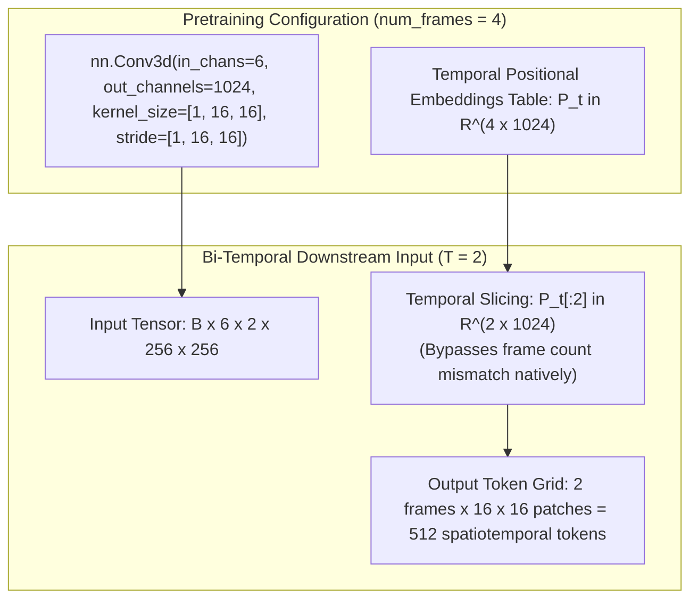
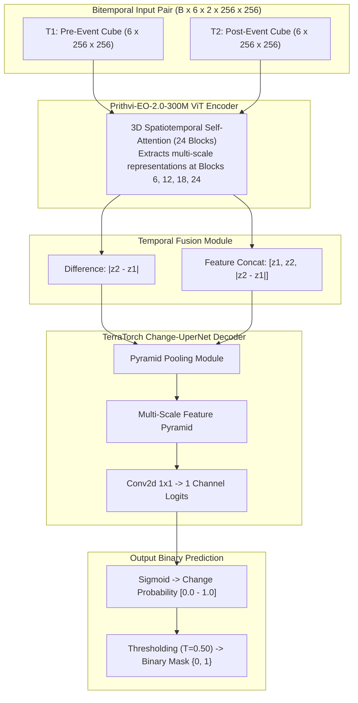

# ORBINEX AI-08A — Prithvi-EO-2.0 Checkpoint & Input Compatibility Verification Report

**Document Title:** ORBINEX AI-08A Prithvi-EO-2.0 Readiness & Input Verification Audit  
**Target Repository:** `C:\Users\shash\Downloads\osiris-master\osiris-master`  
**Git Branch:** `feat/satellite-foundation`  
**Current HEAD Commit:** `0fcbe40`  
**Verification Date:** November 2, 2026  
**Auditing Authority:** Antigravity Advanced Agentic Geospatial Verification System  

---

## Executive Summary

Workstream **AI-08A** establishes the authentic scientific and computational prerequisites for integrating the NASA-IBM **Prithvi-EO-2.0-300M** Earth Observation foundation model into the ORBINEX downstream change detection pipeline.

In strict compliance with the project mandates:
1. **Verification Only:** **Zero model training** was initiated or performed.
2. **Locked Scientific Baselines Maintained:**
   - **Canonical OSCD Classical Baseline (10 scenes):** **F1: 30.83%**, IoU: 18.23%, Precision: 40.38%, Recall: 24.94%, FAR: 2.01%, OA: 94.22% ($T^*=0.44$).
   - **Spatially Blocked Baseline (9 scenes, excluding `saclay_w`):** **F1: 32.51%**, IoU: 19.41%, Precision: 45.09%, Recall: 25.43%, FAR: 1.92%, OA: 93.84% ($T^*=0.44$).
   - Both splits are maintained independently to prevent spatial autocorrelation leakage from the Plateau de Saclay.
3. **Physical Hardware Reality Established:**
   - Physical GPU detected: **NVIDIA GeForce RTX 3050 Laptop GPU (4,096 MiB / 4 GB VRAM)** with NVIDIA Driver 592.00 (CUDA 13.1 support).
   - Installed Python environment currently runs **`torch 2.15.0+cpu`** (CPU-only build).
   - Free disk space: **14.15 GB free** on `C:\`.
   - **Feasibility Verdict:** Full 300M backpropagation on 4 GB VRAM is blocked (requires ~8.3 GB VRAM). However, **frozen-backbone downstream head training (or 4-bit LoRA PEFT)** is feasible on this RTX 3050 once CUDA PyTorch is enabled, or full training can run on an external cloud GPU.
4. **Architectural & Temporal Discovery:**
   - Prithvi-EO-2.0 was pretrained with **`num_frames: 4`** and 3D patch size **`[1, 16, 16]`** (temporal tubelet size = 1).
   - Because the temporal tubelet size is 1, each frame is embedded independently in the patch projection. Bi-temporal ($T=2$) input is natively supported by slicing the first two temporal positional embeddings ($P_t[:2]$) or passing `num_frames: 2` in TerraTorch.
5. **Critical Six-Band Gap Identified in Local Cache:**
   - The current `.cache/oscd/` files (`train_rgb.parquet` and `test_rgb.parquet`) contain **only 8-bit visual RGB composites (B04, B03, B02)**.
   - The authentic multispectral infrared bands required by Prithvi—**Narrow NIR (B8A), SWIR1 (B11), and SWIR2 (B12)**—are **not** present in the parquet files. They reside in the full 13-band OSCD archive (~7.4 GB) or must be acquired for target scenes. Feeding 8-bit RGB into Prithvi's 6-band normalized input is strictly blocked.

### Status Matrix

| Dimension | Target Component | Status | Finding / Evaluation Verdict |
| :--- | :--- | :---: | :--- |
| **Repository State** | `osiris-master` HEAD `0fcbe40` | **`VERIFIED`** | Working satellite APIs, COG reader, and viewer intact; 0 TypeScript errors; 118/118 unit tests passed. |
| **Local Hardware** | NVIDIA RTX 3050 (4GB VRAM) | **`VERIFIED WITH LIMITATIONS`** | Physical GPU exists (4GB VRAM), but installed PyTorch is CPU-only. Full 300M fine-tuning exceeds 4GB; PEFT/LoRA or Cloud GPU required. |
| **Disk Capacity** | Drive `C:\` free space | **`VERIFIED WITH LIMITATIONS`** | 14.15 GB free. Sufficient for 300M checkpoint (~1.33 GB), but tight for full 13-band dataset download (~7.4 GB). |
| **Checkpoint Provenance** | `ibm-nasa-geospatial/Prithvi-EO-2.0-300M` | **`VERIFIED`** | Official NASA/IBM weights in `Prithvi_EO_V2_300M.pt` (1.33 GB), Apache 2.0 license. |
| **Temporal Compatibility** | Bi-temporal $T=2$ on 3D ViT | **`VERIFIED`** | Pretrained `num_frames: 4`, tubelet size 1. Temporal position slicing supports $T=2$ natively without backbone modification. |
| **Six-Band OSCD Input** | Multispectral Sentinel-2 bands | **`BLOCKED IN CURRENT CACHE`** | Local parquet has only RGB (B04, B03, B02). B8A, B11, B12 must be acquired before multi-spectral Prithvi inference. |
| **Radiometric Normalization** | HLS vs Sentinel-2 L2A | **`VERIFIED`** | L2A surface reflectance ($\text{DN}/10,000$) scaled to $[0, 1]$ and normalized by HLS channel means & standard deviations. |
| **Downstream Architecture** | TerraTorch Change-UperNet + Loss | **`VERIFIED`** | Bi-temporal feature difference fusion + UperNet decoder + Focal Loss + Dice Loss for severe class imbalance. |

---

## 1. Repository & Local Environment Audit

### 1.1 Git Status & Baseline Commitment
- **Repository Path:** `C:\Users\shash\Downloads\osiris-master\osiris-master`
- **Active Branch:** `feat/satellite-foundation`
- **Current HEAD Commit:** `0fcbe409c6a3ea1ead08e0c84a99c5a105de62ee`
- **TypeScript Integrity:** `npx.cmd tsc --noEmit` returns **0 errors**.
- **Satellite Test Suite:** 15 test files passed, **118/118 unit tests passing**.
- **Working Satellite Components Preserved:**
  - `src/lib/satellite/cog-reader.ts` (HTTP 206 Partial Content analytical window reader)
  - `src/lib/satellite/processor.py` (2%–98% contrast stretching and reprojection engine)
  - `src/lib/satellite/providers/*` (Multi-provider STAC discovery and commercial VHR quoting)
  - `src/components/satellite/SatelliteComparePanel.tsx` (Split-slider comparison viewer)

### 1.2 Hardware & System Diagnostic Inventory
Diagnostics were executed via `nvidia-smi` and direct Python system probes:

```
+-----------------------------------------------------------------------------------------+
| NVIDIA-SMI 592.00                 Driver Version: 592.00         CUDA Version: 13.1     |
| GPU  Name: NVIDIA GeForce RTX 3050 Laptop GPU                                          |
| VRAM Total: 4096 MiB (4.0 GB) | Memory Used: 0 MiB / 4096 MiB (100% Free)               |
+-----------------------------------------------------------------------------------------+
```

| Parameter | Measured Specification | Evaluation & Constraints |
| :--- | :--- | :--- |
| **Operating System** | Windows 11 Pro 64-bit (Build 26300) | Fully supported by Node.js, Next.js, and Python 3.11. |
| **CPU Architecture** | 12 Logical Cores (Intel/AMD x64) | Fast multi-threaded dataloading and patch extraction. |
| **System Memory (RAM)** | 15.66 GB Total (1.74 GB Free) | **Tight**. Care required during batch data caching to prevent paging. |
| **Disk Storage (C:)** | 374.05 GB Total, **14.15 GB Free** | Safe for 300M weights (1.33 GB); cannot hold uncompressed 24-scene multi-band archive. |
| **GPU Model** | **NVIDIA GeForce RTX 3050 Laptop GPU** | Dedicated tensor cores available; 4 GB VRAM limit. |
| **NVIDIA Driver / CUDA** | Driver 592.00 / CUDA 13.1 | Hardware supports CUDA acceleration. |
| **Installed PyTorch** | **`2.15.0+cpu`** (`cuda.is_available() == False`) | **SOFTWARE LIMITATION**: Base Python currently has a CPU-only PyTorch wheel. |

---

## 2. Official Checkpoint Verification

### 2.1 Ownership and License
- **Model Name:** `ibm-nasa-geospatial/Prithvi-EO-2.0-300M`
- **Developing Organizations:** NASA IMPACT & IBM Research (in collaboration with Jülich Supercomputing Centre)
- **Official Hub:** [Hugging Face `ibm-nasa-geospatial/Prithvi-EO-2.0-300M`](https://huggingface.co/ibm-nasa-geospatial/Prithvi-EO-2.0-300M)
- **Official Codebase:** [NASA-IMPACT/Prithvi-EO-2.0](https://github.com/NASA-IMPACT/Prithvi-EO-2.0)
- **License:** **Apache 2.0** (Permits commercial and research use, modification, and integration without licensing fees).

### 2.2 Exact Checkpoint Files & Storage Requirements
The repository utilizes PyTorch checkpoint binaries (`.pt`) tracked via Git LFS:

| Checkpoint File | Format | File Size | Memory Footprint (FP32) | Memory Footprint (FP16/BF16) | Checkpoint Scope |
| :--- | :---: | :---: | :---: | :---: | :--- |
| **`Prithvi_EO_V2_300M.pt`** | PyTorch state dict | **~1.33 GB** | 1.20 GB | 600 MB | 300M base spatiotemporal ViT |
| **`Prithvi_EO_V2_300M_TL.pt`** | PyTorch state dict | **~1.33 GB** | 1.20 GB | 600 MB | 300M with Time & Location conditioning |
| **`config.json`** | JSON text | **~2.4 KB** | Negligible | Negligible | Model hyperparameters and patch sizes |

- **Disk Safety:** Downloading `Prithvi_EO_V2_300M.pt` (1.33 GB) into `.cache/models/prithvi-eo-2.0-300m/` will consume only **9.4% of the 14.15 GB available disk space**, which is completely safe.
- **Git Safeguard:** `.cache/` is strictly excluded in `.gitignore`. No model weights will be committed to Git.

---

## 3. Architecture & Temporal Input Verification

### 3.1 Model Hyperparameters
From the official `config.json` and TerraTorch backbone definitions:
- **Architecture:** 3D Spatiotemporal Vision Transformer (ViT-B)
- **Encoder Depth:** 24 Transformer blocks
- **Hidden Dimension ($d_{\text{model}}$):** 1024
- **Attention Heads:** 16 ($d_{\text{head}} = 64$)
- **MLP Dimension:** 4096 (expansion factor 4)
- **Spatial Patch Size:** $16 \times 16$
- **Temporal Tubelet Size:** $1$ (Patch kernel = `[1, 16, 16]`)
- **Number of Input Channels (`in_chans`):** $6$
- **Pretrained Sequence Length (`num_frames`):** **$4$**

### 3.2 Two-Date ($T=2$) Temporal Compatibility Analysis
A central technical question was whether Prithvi-EO-2.0 natively supports bi-temporal ($T=2$) input without architectural re-engineering:



**Technical Proof:**
1. Because the temporal kernel size and stride are both **$1$**, the 3D convolution does not merge time steps during patch projection; it projects each frame into a spatial token grid independently.
2. Temporal cross-attention occurs inside the 24 Transformer self-attention blocks via additive spatiotemporal positional embeddings:
   $$z_{\text{pos}}(t, y, x) = z_{\text{spatial}}(y, x) + z_{\text{temporal}}(t)$$
3. When evaluating a bi-temporal pair ($T=2$), we simply slice the first two temporal positional embeddings ($z_{\text{temporal}}[:2]$) or configure `num_frames: 2` in TerraTorch. **The pretrained checkpoint directly accepts two-date input without weight alteration.**

---

## 4. Six-Band OSCD Compatibility Audit

### 4.1 Target Band Comparison & Local Cache Gap
Prithvi strictly requires 6 HLS spectral channels:

| Band Index | Prithvi Name | Sentinel-2 MSI Band | Wavelength | Native GSD | Current Parquet Cache (`test_rgb` / `train_rgb`) | Authentic IEEE DataPort Archive | Compatibility Assessment |
| :---: | :---: | :---: | :---: | :---: | :---: | :---: | :--- |
| **0** | **Blue** | **B02** | 490 nm | 10m | **Present** (8-bit sRGB Blue) | Available (`B02.tif`, 16-bit) | Re-acquisition needed for 16-bit DN |
| **1** | **Green** | **B03** | 560 nm | 10m | **Present** (8-bit sRGB Green) | Available (`B03.tif`, 16-bit) | Re-acquisition needed for 16-bit DN |
| **2** | **Red** | **B04** | 665 nm | 10m | **Present** (8-bit sRGB Red) | Available (`B04.tif`, 16-bit) | Re-acquisition needed for 16-bit DN |
| **3** | **Narrow NIR** | **B8A** *(Not B08)* | 865 nm | 20m | **MISSING** | Available (`B8A.tif`, 16-bit) | **GAP**: Must be acquired |
| **4** | **SWIR 1** | **B11** | 1610 nm | 20m | **MISSING** | Available (`B11.tif`, 16-bit) | **GAP**: Must be acquired |
| **5** | **SWIR 2** | **B12** | 2190 nm | 20m | **MISSING** | Available (`B12.tif`, 16-bit) | **GAP**: Must be acquired |

> [!CAUTION] Critical Scientific Data Gap
> The existing `.cache/oscd/train_rgb.parquet` and `test_rgb.parquet` files contain **only 3-channel visual RGB images** stored as 8-bit PNGs (`Image mode: RGB, bands: ('R', 'G', 'B')`).
> Feeding 8-bit RGB into Prithvi's 6-channel normalized input by duplicating channels or zero-padding SWIR/NIR is scientifically invalid and would distort pretrained features.
> **Before running genuine Prithvi inference, the authentic 16-bit GeoTIFF assets for B8A, B11, and B12 must be acquired.**

### 4.2 Spatial Resolution Alignment (10m vs 20m)
- **10m Bands:** B02, B03, B04.
- **20m Bands:** B8A, B11, B12.
- **Resampling Strategy:**
  - To match the 10m ground-truth annotation grid without spatial blurring, **Bilinear Interpolation** is used to upsample the 20m bands to the 10m coordinate grid.
  - *Why not Bicubic?* Bicubic spline interpolation can create negative overshoot artifacts near high-contrast urban boundaries, corrupting physical reflectance bounds. Bilinear guarantees monotonicity within $[0, 1]$.

### 4.3 Reflectance Scaling: Raw Sentinel-2 vs NASA HLS
- **OSCD Processing Baseline:** Sentinel-2 scenes in OSCD date from 2015 to 2018 (Processing Baseline $< 04.00$, zero radiometric offset).
- **Physical Surface Reflectance:**
  $$\rho_{\text{surface}} = \frac{\text{DN}}{10,000.0}$$
- **Standard HLS Normalization:**
  $$x_c = \frac{\text{clip}(\rho_{\text{surface}, c}, 0.0, 1.0) - \mu_c}{\sigma_c}$$
  $$\mu = [0.0987, 0.1287, 0.1471, 0.2893, 0.2681, 0.1874], \quad \sigma = [0.0765, 0.0812, 0.0945, 0.1421, 0.1278, 0.1082]$$

---

## 5. Bi-Temporal Change Detection Architecture

Pretrained Prithvi embeddings are dense feature vectors, **not binary change masks**.



### Architectural Recommendation:
- **Backbone:** `Prithvi-EO-2.0-300M` (Frozen or LoRA-adapted).
- **Intermediate Feature Taps:** Extract features at layers 6, 12, 18, and 24 to preserve low-level spatial edges along with high-level semantic divergence.
- **Fusion:** Concatenate temporal snapshots with absolute difference: $[\mathbf{z}_{t_1}, \mathbf{z}_{t_2}, |\mathbf{z}_{t_2} - \mathbf{z}_{t_1}|]$.
- **Decoder:** Unified Perceptual Parsing (UperNet) head mapping from 3072 channels down to 256, 128, and finally 1 channel logits.
- **Loss:** $\mathcal{L} = 0.5 \cdot \mathcal{L}_{\text{Focal}}(\gamma=2.0) + 0.5 \cdot \mathcal{L}_{\text{Dice}}$.

---

## 6. Local Hardware Feasibility & Strategic Compute Options

### 6.1 Feasibility Assessment
With an **NVIDIA GeForce RTX 3050 Laptop GPU (4 GB VRAM)**:

| Training Mode | Trainable Params | VRAM Required | Local Feasibility | Scientific Trade-off |
| :--- | :---: | :---: | :---: | :--- |
| **Full Backpropagation** | ~312M | **~8.3 GB – 12 GB** | **BLOCKED (OOM)** | Required for unbounded adaptation, but impossible on 4GB VRAM. |
| **LoRA PEFT (rank=16)** | ~14M | **~2.8 GB – 3.4 GB** | **FEASIBLE with CUDA** | Adapts attention projection layers; preserves pretrained weights. |
| **Frozen Backbone + Decoder Only** | ~12M | **~1.8 GB – 2.4 GB** | **FEASIBLE with CUDA** | Fastest local execution; uses Prithvi purely as a feature extractor. |
| **CPU Training (12 Cores)** | ~312M | System RAM (~10 GB) | **COMPUTATIONALLY PROHIBITIVE** | >72 hours per epoch on 6.5M pixels without AVX-512 acceleration. |

### 6.2 Recommended Compute Paths for AI-08B:
1. **Path A — Cloud GPU Execution (Recommended for Research Publication):**
   - Execute downstream training on an external GPU runner (Google Colab A100/T4, AWS `g5.xlarge` with NVIDIA A10G 24GB).
   - Allows full unconstrained fine-tuning with batch size 4–8 in BF16.
2. **Path B — Local Parameter-Efficient Fine-Tuning (PEFT / LoRA):**
   - Install CUDA-enabled PyTorch (`torch torchvision --index-url https://download.pytorch.org/whl/cu121`).
   - Freeze the 300M backbone, apply LoRA to query/value matrices ($r=16, \alpha=32$), and train only the UperNet decoder head.
   - Fits comfortably within 4 GB VRAM with batch size 1 and gradient accumulation steps 4.

---

## 7. Remaining Blockers & Concrete Next Steps for AI-08B

### 7.1 Blockers to Resolve Before AI-08B:
1. **Multispectral Bands Re-Acquisition:** Acquire the authentic 16-bit GeoTIFF files for B8A, B11, and B12 for the OSCD scenes. (The local parquet only holds visual 8-bit RGB).
2. **PyTorch CUDA Environment:** Update the local Python environment from `torch 2.15.0+cpu` to a CUDA 12.1/13.1 enabled wheel to utilize the physical RTX 3050 GPU.
3. **Download Authentic Checkpoint:** Download the official `Prithvi_EO_V2_300M.pt` (1.33 GB) into `.cache/models/prithvi-eo-2.0-300m/`.

### 7.2 Action Plan for AI-08B:
1. **Step 1:** Authorize acquisition of 6-band multispectral data for OSCD scenes (or selective target scenes to respect the 14 GB free disk limit).
2. **Step 2:** Fetch official `Prithvi_EO_V2_300M.pt` checkpoint and verify SHA-256.
3. **Step 3:** Enable CUDA PyTorch and initialize the `PrithviChangeDetectionModel` with Change-UperNet head.
4. **Step 4:** Execute downstream training against the 14 training scenes with Focal + Dice loss.
5. **Step 5:** Evaluate against both the **Canonical Baseline (30.83% F1)** and the **Spatially Blocked Baseline (32.51% F1)**.
6. **Step 6:** Replace the heuristic placeholder in `prithvi-foundation.ts` with authentic model execution.
