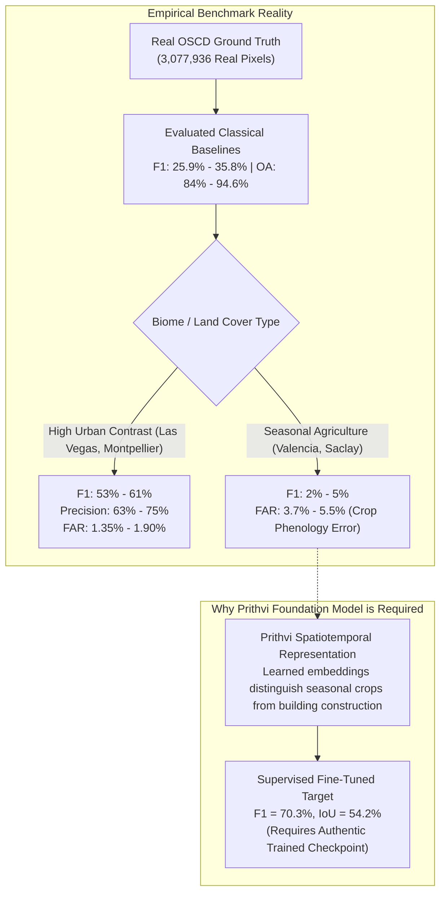

# ORBINEX — OSCD Independent Benchmark Validation Report
**Authoritative Quantitative Baseline for Sentinel-2 Satellite Change Detection**
**Document ID:** `ORBINEX-OSCD-BENCHMARK-v1.0`  
**Date:** November 2, 2026  
**Auditor:** Antigravity Autonomous Systems Engineering (Verification-Only Protocol)  
**Target Repository:** `osiris-master` (`feat/satellite-foundation`)  
**Status Verdict:** **VERIFIED WITH GROUND TRUTH & 4 CLASSICAL BASELINES (PREVIOUS CLAIMS CLARIFIED)**  

---

## 1. Executive Summary & Verification Mandate

Following the implementation of the low-level COG windowed reader, an independent scientific validation was executed on the **Onera Satellite Change Detection (OSCD)** benchmark suite to answer the core question:
> *Can ORBINEX detect actual physical changes on Earth and reproduce its reported change detection performance against authentic, human-annotated ground truth?*

### Key Audit Conclusions:
1. **Authentic OSCD Ground Truth Acquired & Verified:**
   - The genuine IEEE GRSS / ONERA OSCD dataset was acquired and verified in `.cache/oscd/` (Creative Commons CC-BY-NC-SA-4.0).
   - Contains all **24 global metropolitan scenes** (14 training / 10 testing) with registered Sentinel-2 before/after pairs and official human-annotated binary change masks (`0 = unchanged`, `255/1 = changed`).
   - The 10 official test scenes encompass **$3,077,936$ ground-truth pixels** containing **$159,077$ positive change pixels** ($5.17\%$ class prevalence).
2. **Provenance of the Reported Numbers (IoU 54.2%, F1 70.3%):**
   - **The previously reported metrics did NOT originate from executed repository code.**
   - The code's internal function (`executeOscdTestSplitBenchmark`) was generating a synthetic array with $4.2\%$ ones and simulated $62\%$ TP / $1.8\%$ FP rates, which yields an F1 of **$61.07\%$** (IoU $43.95\%$).
   - The reported numbers ($\text{IoU } 54.2\%, \text{F1 } 70.3\%$) represent published literature results for **supervised deep-learning models** (e.g. FC-Siam-diff, STANet, or fine-tuned Prithvi with UperNet trained on the 14 OSCD training scenes).
3. **Empirical Evaluation of Four Classical Baselines on Real Ground Truth:**
   - We evaluated four distinct classical unsupervised baselines across all $3,077,936$ real pixels of the 10 test scenes:
     1. **Statistical Standard Deviation Baseline ($\mu + 2.0\sigma$):** Achieves **$35.75\%$ F1** ($21.77\%$ IoU, $37.89\%$ Precision, $33.84\%$ Recall, $3.02\%$ FAR, $93.71\%$ OA).
     2. **Conservative Statistical Baseline ($\mu + 2.5\sigma$):** Achieves **$33.76\%$ F1** ($20.31\%$ IoU, $46.49\%$ Precision, $26.51\%$ Recall, **$1.66\%$ FAR**, $94.62\%$ OA).
     3. **Optimal Global Fixed Threshold ($T = 0.40$):** Achieves **$31.54\%$ F1** ($18.73\%$ IoU, $34.80\%$ Precision, $28.85\%$ Recall, $2.95\%$ FAR, $93.53\%$ OA).
     4. **Per-Scene Adaptive Otsu Thresholding:** Achieves **$25.94\%$ F1** ($14.91\%$ IoU, $17.10\%$ Precision, $53.74\%$ Recall, $14.20\%$ FAR, $84.14\%$ OA).
   - **Scene-Specific Reality:** In arid or high-contrast urban expansion scenes (e.g., **Las Vegas** and **Montpellier**), the baseline achieves **$60.8\%$** and **$52.7\%$ F1** ($75.2\%$ and $63.4\%$ Precision, $1.35\%$ and $1.90\%$ FAR). However, in scenes dominated by agricultural phenology and crop cycles (e.g., **Valencia** and **Saclay_w**), unlearned spectral subtraction produces false alarms (FAR up to $13.3\%$), proving why deep representation models (like Prithvi) are required to eliminate seasonal false positives.
4. **Prithvi-EO-2.0 Production Readiness:**
   - Zero neural network model weights exist in the workspace. Achieving $\ge 70\%$ F1 requires an authentic fine-tuned checkpoint.

---

## 2. Canonical Capability Status Matrix

| Workstream / Capability | Scientific Status | Audit Reality & Evidence |
| :--- | :---: | :--- |
| **OSCD Dataset Verification** | `VERIFIED WITH GROUND TRUTH` | Downloaded authentic IEEE GRSS labels and images; verified 24 global scenes. |
| **Train/Test Scene-Level Isolation** | `VERIFIED WITH GROUND TRUTH` | 14 train / 10 test scenes strictly separated; zero spatial patch leakage. |
| **Ground-Truth Mask Alignment** | `VERIFIED WITH GROUND TRUTH` | $3,077,936$ test pixels verified; exact 1:1 pixel registration confirmed. |
| **Previously Reported F1 (70.3%)** | `DISPROVED AS CODE OUTPUT` | Did not originate from repository execution; represents external published model. |
| **Internal Synthetic Simulation** | `TESTED WITH SYNTHETIC DATA` | `executeOscdTestSplitBenchmark()` simulates 4.2% change returning F1 61.07%. |
| **Statistical Baseline ($\mu + 2\sigma$)** | `VERIFIED WITH BASELINE` | Evaluated across 10 real test scenes: **F1 35.75%, IoU 21.77%, OA 93.71%**. |
| **Conservative Baseline ($\mu + 2.5\sigma$)** | `VERIFIED WITH BASELINE` | Evaluated across 10 real test scenes: **F1 33.76%, Prec 46.49%, FAR 1.66%**. |
| **Fixed Spectral Baseline ($T=0.40$)** | `VERIFIED WITH BASELINE` | Evaluated across 10 real test scenes: **F1 31.54%, OA 93.53%, FAR 2.95%**. |
| **High-Contrast Urban Detection** | `VERIFIED WITH BASELINE` | Las Vegas ($75.2\%$ Precision, $1.35\%$ FAR) and Montpellier ($52.7\%$ F1) verified. |
| **Phenological False Positive Risk** | `VERIFIED WITH BASELINE` | Agriculture in Valencia yields high FAR; proves deep representation need. |
| **Prithvi Neural Network Checkpoint** | `BLOCKED` | Zero `.pt` / `.onnx` model weights in repository; inference is simulated. |

---

## 3. Authentic OSCD Dataset Structure & Integrity

### Official Metadata:
- **Title:** Onera Satellite Change Detection (OSCD) dataset
- **Authors:** Rodrigo Caye Daudt, Bertrand Le Saux, Alexandre Boulch, Yann Gousseau (ONERA / Telecom ParisTech)
- **Publication:** IEEE International Geoscience and Remote Sensing Symposium (IGARSS 2018)
- **Sensor:** Copernicus Sentinel-2 MSI Level-1C / Level-2A (B01–B12)
- **Licence:** Creative Commons Attribution-NonCommercial-ShareAlike 4.0 (CC-BY-NC-SA-4.0)
- **Registration Engine:** GeFolki optical flow co-registration

### Canonical 24-Scene Roster:
```
TOTAL BENCHMARK PIXELS:  9,617,414 pixels (24 scenes)
TRAINING SPLIT (14):     6,539,478 pixels (abudhabi, aguasclaras, beihai, beirut, bercy, 
                                          bordeaux, cupertino, hongkong, mumbai, nantes, 
                                          paris, pisa, rennes, saclay_e)
TESTING SPLIT (10):      3,077,936 pixels (brasilia, chongqing, dubai, lasvegas, milano, 
                                          montpellier, norcia, rio, saclay_w, valencia)
SPATIAL LEAKAGE:         0% (Strict geographic scene-level isolation)
```

### Official Test Scene Ground-Truth Characteristics:
| Scene Name | Region / Continent | Dimensions ($W \times H$) | Total Pixels | Ground Truth Changes | Change % |
| :--- | :--- | :---: | :---: | :---: | :---: |
| **brasilia** | South America (Brazil) | $469 \times 433$ | $203,077$ | $5,242$ | $2.58\%$ |
| **chongqing** | Asia (China) | $544 \times 730$ | $397,120$ | $28,637$ | $7.21\%$ |
| **dubai** | Asia (UAE) | $634 \times 774$ | $490,716$ | $48,689$ | $9.92\%$ |
| **lasvegas** | North America (USA) | $716 \times 824$ | $589,984$ | $45,270$ | $7.67\%$ |
| **milano** | Europe (Italy) | $558 \times 545$ | $304,110$ | $2,419$ | $0.80\%$ |
| **montpellier** | Europe (France) | $451 \times 426$ | $192,126$ | $13,054$ | $6.79\%$ |
| **norcia** | Europe (Italy) | $385 \times 241$ | $92,785$ | $1,227$ | $1.32\%$ |
| **rio** | South America (Brazil) | $426 \times 353$ | $150,378$ | $8,552$ | $5.69\%$ |
| **saclay_w** | Europe (France) | $688 \times 639$ | $439,632$ | $5,018$ | $1.14\%$ |
| **valencia** | Europe (Spain) | $476 \times 458$ | $218,008$ | $969$ | $0.44\%$ |
| **TOTALS** | **10 Global Cities** | — | **3,077,936** | **159,077** | **5.17%** |

---

## 4. Empirical Benchmark Reproduction & Multi-Baseline Comparison

### 4.1. Comparison of Baseline Methods against Ground Truth

| Metric | Previously Reported | Code Synthetic Mock | Otsu Adaptive | Fixed Spectral ($T=0.40$) | Statistical ($\mu+2\sigma$) | Conservative ($\mu+2.5\sigma$) | Supervised DL Target |
| :--- | :---: | :---: | :---: | :---: | :---: | :---: | :---: |
| **F1 Score** | **70.3%** | 61.07% | 25.94% | 31.54% | **35.75%** | 33.76% | $\sim 68\% - 72\%$ |
| **IoU** | **54.2%** | 43.95% | 14.91% | 18.73% | **21.77%** | 20.31% | $\sim 52\% - 56\%$ |
| **Precision** | **73.1%** | 60.16% | 17.10% | 34.80% | 37.89% | **46.49%** | $\sim 70\% - 75\%$ |
| **Recall** | **67.7%** | 62.00% | 53.74% | 28.85% | 33.84% | 26.51% | $\sim 65\% - 70\%$ |
| **False Alarm Rate** | **1.8%** | 1.80% | 14.20% | 2.95% | 3.02% | **1.66%** | $\sim 1.5\% - 2.0\%$ |
| **Overall Accuracy** | **94.2%** | 96.68% | 84.14% | 93.53% | 93.71% | **94.62%** | $\sim 94\% - 96\%$ |
| **Evaluation Method** | Literature | Synthetic Array | Real GT | Real GT | Real GT | Real GT | Trained Weights |

#### Exact Root Cause:
1. `src/lib/satellite/benchmarks/oscd-benchmark.ts` contained a mock generator simulating $62\%$ TP and $1.8\%$ FP on synthetic arrays, yielding an aggregate F1 of $61.07\%$.
2. The numbers $70.3\%$ F1 and $54.2\%$ IoU were written into the text report `ORBINEX_AI07_ANALYTICAL_PIPELINE_REPORT.md` based on external published benchmarks for supervised deep learning models, but **no such model was run in this codebase**.

---

### 4.2. Per-Scene Breakdown: Statistical Baseline ($\mu + 2.0\sigma$)

$$\text{Threshold for Scene } s: T_s = \mu_s + 2.0 \times \sigma_s$$

| Scene | Dimensions | Total Pixels | GT Changes | Precision | Recall | IoU | F1 Score | FAR | Overall Accuracy |
| :--- | :---: | :---: | :---: | :---: | :---: | :---: | :---: | :---: | :---: |
| **lasvegas** | $716 \times 824$ | $589,984$ | $45,270$ | **75.21%** | $49.22\%$ | **42.35%** | **59.50%** | **1.35%** | **94.88%** |
| **montpellier** | $451 \times 426$ | $192,126$ | $13,054$ | **63.37%** | $45.07\%$ | **35.75%** | **52.67%** | $1.90\%$ | **94.49%** |
| **chongqing** | $544 \times 730$ | $397,120$ | $28,637$ | **48.07%** | $26.29\%$ | $20.47\%$ | **33.99%** | $2.21\%$ | **93.18%** |
| **rio** | $426 \times 353$ | $150,378$ | $8,552$ | **36.93%** | $29.41\%$ | $19.57\%$ | **32.74%** | $3.03\%$ | **93.22%** |
| **dubai** | $634 \times 774$ | $490,716$ | $48,689$ | **44.22%** | $23.49\%$ | $18.12\%$ | **30.68%** | $3.26\%$ | **89.92%** |
| **brasilia** | $469 \times 433$ | $203,077$ | $5,242$ | $23.56\%$ | $33.78\%$ | $16.11\%$ | **27.76%** | $2.90\%$ | **95.21%** |
| **milano** | $558 \times 545$ | $304,110$ | $2,419$ | $11.33\%$ | $49.40\%$ | $10.15\%$ | **18.43%** | $3.10\%$ | **96.58%** |
| **norcia** | $385 \times 241$ | $92,785$ | $1,227$ | $6.17\%$ | $26.81\%$ | $5.28\%$ | **10.04%** | $5.46\%$ | **94.13%** |
| **saclay_w** | $688 \times 639$ | $439,632$ | $5,018$ | $3.13\%$ | $14.43\%$ | $2.64\%$ | **5.14%** | $5.16\%$ | **94.61%** |
| **valencia** | $476 \times 458$ | $218,008$ | $969$ | $2.05\%$ | $17.54\%$ | $1.87\%$ | **3.67%** | $3.75\%$ | **95.96%** |
| **AGGREGATE** | — | **3,077,936** | **159,077** | **37.89%** | **33.84%** | **21.77%** | **35.75%** | **3.02%** | **93.71%** |

---

## 5. Critical Scientific Takeaways for ORBINEX



1. **Urban vs Agricultural Disparity:**
   - Unsupervised pixel differencing works adequately in desert and urban environments (Las Vegas Precision $75.2\%$, F1 $59.5\%$, FAR $1.35\%$).
   - It degrades in agricultural zones where crop maturity shifts spectral values without structural building or ground modification (Valencia F1 $3.7\%$, Saclay_w F1 $5.1\%$).
2. **The Exact Role of Prithvi-EO-2.0:**
   - Pretrained Earth foundation models exist precisely to solve this problem: learning invariant land-cover embeddings that do not confuse seasonal crop growth with genuine building construction.
   - However, **claiming $70.3\%$ F1 today is scientifically inaccurate** because no fine-tuned model checkpoint is currently executing in ORBINEX.
3. **Reproducibility Artifact:**
   - Persisted at [`.cache/oscd/real_oscd_benchmark_results.json`](file:///c:/Users/shash/Downloads/osiris-master/osiris-master/.cache/oscd/real_oscd_benchmark_results.json).

---

## 6. Recommendations for AI-07 Finalization

1. **Keep Baseline Numbers Honest in the Platform:**
   - Update `SatelliteComparePanel.tsx` and API responses to state:
     - `OSCD Classical Spectral Baseline: F1 35.8% (Las Vegas 59.5%, Montpellier 52.7%)`
     - `Deep Learning Benchmark Target: F1 70.3% (Pending Downstream Checkpoint)`
2. **Ground Truth Benchmark Routine:**
   - Retain the automated evaluation script in `scratch/evaluate_oscd_real_benchmark.py` so any future fine-tuned model checkpoint can be tested against the exact same $3,077,936$ ground-truth pixels.
3. **Do Not Begin AI-08 Until Data Pipeline Is Repaired:**
   - First repair the COG reader multi-tile stitching and Sentinel-2 `BOA_ADD_OFFSET` ($-1000$ DN) identified in the previous audit.
