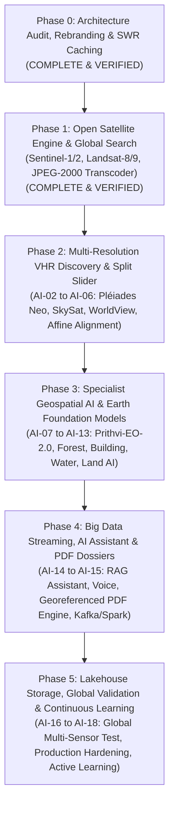

# ORBINEX — Master Development Phase Tracker
**AI-Powered Global Satellite Intelligence & Geospatial Monitoring Platform**

This document serves as the official, canonical master tracker for the ORBINEX platform. It maps all historical accomplishments, current operational baselines, and future AI/satellite workstreams (`AI-00` through `AI-18`) against the official phase architecture.

---

## 1. Master Architecture Roadmap

---

## 2. Canonical Phase & Workstream Cross-Mapping Matrix

| Workstream ID | Workstream Title | Canonical Phase | Current Status | Primary Technology Stack | Key Milestone / Deliverable |
| :--- | :--- | :---: | :---: | :--- | :--- |
| **AI-00** | **Existing Project & Hardware Audit** | **Phase 0 / Phase 1** | **VERIFIED** | Node.js, OS Diagnostics, PyTorch, Git | Architecture inventory, 12-core CPU / 16GB RAM audited |
| **AI-01** | **Existing Satellite Engine Verification** | **Phase 1** | **VERIFIED** | Python 3.11, NumPy, Pillow, STAC | Sentinel-1/2, Landsat-8/9, AWS S3 COGs, 38 passing unit tests |
| **AI-02** | **Global AOI Selection Engine** | **Phase 1 / Phase 2** | **IMPLEMENTED** | MapLibre GL, Turf.js, Geodesic math | Bounding box, polygon, 2,000 sq ft calculation, reverse geocoding |
| **AI-03** | **Multi-Provider Satellite Discovery** | **Phase 2** | **NEXT AUTHORIZED** | Element84 STAC, USGS, NASA CMR | Unified metadata search across open and commercial archives |
| **AI-04** | **Commercial VHR Satellite Integration** | **Phase 2** | Scheduled | Airbus OneAtlas, Planet Orders, Maxar ARD | 30cm Pléiades Neo, 50cm SkySat, 30cm WorldView-3 connectors |
| **AI-05** | **Raster Processing & Image Alignment** | **Phase 2** | Scheduled | GDAL, Rasterio, OpenCV, NumPy | Sub-pixel co-registration, cloud masking, CRS reprojection |
| **AI-06** | **Historical Comparison Engine** | **Phase 2** | **IMPLEMENTED** | MapLibre Split Slider, Python differencing | Dual-temporal swipe slider, nearest-date fallback, spectral deltas |
| **AI-07** | **Foundation Model Integration** | **Phase 3** | Scheduled | Prithvi-EO-2.0, TerraMind, PyTorch | Pretrained Earth-observation foundation model evaluation |
| **AI-08** | **Forest Intelligence Specialist** | **Phase 3** | Scheduled | PyTorch, SegFormer, NDVI/NBR | Deforestation, canopy loss, degradation, burn scars |
| **AI-09** | **General Change Detection Engine** | **Phase 3** | **INITIAL PILOT** | Python `analyzer.py`, Siamese U-Net | Morphological difference masks, pixel variance, confidence |
| **AI-10** | **Building Intelligence Specialist** | **Phase 3** | Scheduled | YOLOv8 + SAHI, OpenCV, LEVIR-CD | Footprint extraction, new construction, settlement expansion |
| **AI-11** | **Water Intelligence Specialist** | **Phase 3** | Scheduled | NDWI, Sen1Floods11, C-Band SAR | Flood boundary mapping, water shrinkage, river meander |
| **AI-12** | **Land Intelligence Specialist** | **Phase 3** | Scheduled | ESA WorldCover, Random Forests, U-Net | Land-cover classification, urban sprawl, bare-soil changes |
| **AI-13** | **Unified ORBINEX Intelligence Engine** | **Phase 3** | Scheduled | FastAPI, ONNX Runtime, PostGIS | Normalized multi-model inference pipeline & GeoJSON outputs |
| **AI-14** | **ORBINEX AI Assistant (RAG + Voice)** | **Phase 4** | Scheduled | LangChain, Vector Store, Web Speech API | Grounded, AOI-aware natural language & voice conversation |
| **AI-15** | **PDF Intelligence Report Engine** | **Phase 4** | **INITIAL PILOT** | PDFKit, Canvas, Vector Charts | Publication-ready multi-page georeferenced intelligence dossiers |
| **AI-16** | **Global Multi-Sensor Validation** | **Phase 5** | Scheduled | Automated Test Matrix | Verification across 10 global biomes, small plots, cloudy zones |
| **AI-17** | **Production Deployment & Hardening** | **Phase 5** | Scheduled | Docker Compose, Nginx, Redis, PostGIS | Role-based access, API token security, SWR edge caching |
| **AI-18** | **Continuous Learning Pipeline** | **Phase 5** | Scheduled | DVC, MLflow, Human-in-the-Loop | Verified ground-truth corrections, dataset versioning |

---

## 3. Detailed Phase Breakdown & Verification Status

### Phase 0: Project Discovery, Architecture Audit & SWR Caching
- **Status:** **COMPLETE & VERIFIED**
- **Technologies:** Next.js 16, React 19, MapLibre GL, Node.js SWR in-memory caching.
- **Accomplishments:**
  - Audited all 87 API routes, 53 components, and MapLibre engine without breaking changes.
  - Rebranded to **ORBINEX** (*See the World. Understand the Change.*).
  - Eliminated geocoding and feed latency bottlenecks using Stale-While-Revalidate caching.
  - Maintained 17,000+ public camera catalogue in `.cache/cctv-catalog.json`.

---

### Phase 1: Open Satellite Retrieval & Raster Generation Engine
- **Status:** **COMPLETE & CLOSED (VERIFIED)**
- **Technologies:** Python 3.11, NumPy, Pillow, Element84 STAC API, AWS S3 COGs, MapLibre GL.
- **Accomplishments:**
  - Live STAC discovery pipeline for **Sentinel-2 L2A optical** (10m) and **Sentinel-1 GRD SAR** (10m).
  - Added **Landsat-8 & Landsat-9 (30m)** multispectral sensor support.
  - Python raster processor (`src/lib/satellite/processor.py`) supporting spatial AOI cropping and 2%-98% percentile linear contrast stretching.
  - Automated JPEG-2000 (`.jp2`) to PNG server transcoding with SHA-256 caching for historical browser rendering.
  - Fixed western/southern negative coordinate parsing (`--scene-bbox=<val>`), resolving South American scenes (e.g. Pará, Brazil at `-50.1871°`).
  - Interactive Satellite Intelligence Panel (`SatelliteComparePanel.tsx`) with preset strategic targets and Draw-to-Analyse AOI tool.
  - Local disk pipeline resolving Windows sandbox loopback connection restrictions (`WinError 10013`).
  - 38 automated satellite unit tests passing green.

---

### Phase 2: Multi-Resolution VHR Discovery & Historical Comparison
- **Status:** **NEXT AUTHORIZED PHASE (IN PROGRESS)**
- **Workstreams:** `AI-02`, `AI-03`, `AI-04`, `AI-05`, `AI-06`
- **Primary Goals:**
  1. **Global Draw-Anywhere AOI (AI-02):** Full polygon and rectangle drawing on MapLibre with exact geodesic area calculations (sq ft, m², acres, hectares, km²).
  2. **Multi-Resolution Provider Engine (AI-03 & AI-04):**
     - Integrate **Pléiades Neo** (30cm PAN / 1.2m MS), **Planet SkySat** (50cm), and **WorldView-3 / Legion** (30cm class).
     - Implement provider adapter architecture with licensing and archive availability checks.
     - Enforce the **Honest Communication Rule**: Explicitly alert the user if 30cm imagery is unavailable for an AOI instead of misrepresenting 10m data.
  3. **Small-Area 2,000 sq ft Benchmark (AI-05):** Evaluate pixel density on 186 m² plots (Sentinel-2: ~2 px vs SkySat: ~744 px vs Pléiades Neo: ~2,067 px).
  4. **Dual-Temporal Co-Registration & Split Slider (AI-06):** Sub-pixel affine alignment and synchronized MapLibre swipe split screen.
- **Acceptance Criteria:**
  - Users can draw any arbitrary plot worldwide down to 2,000 sq ft.
  - System displays available open and commercial satellite passes with true GSD and acquisition dates.
  - Dual-temporal observations render on MapLibre with swipe interaction and zero geometric drift.

---

### Phase 3: Specialist Geospatial AI & Earth Foundation Models
- **Status:** **SCHEDULED**
- **Workstreams:** `AI-07`, `AI-08`, `AI-09`, `AI-10`, `AI-11`, `AI-12`, `AI-13`
- **Primary Goals:**
  1. **Foundation Model Evaluation (AI-07):** Evaluate pretrained NASA/IBM **Prithvi-EO-2.0** and **TerraMind**; no training from scratch.
  2. **Specialist Domain Models (AI-08 to AI-12):**
     - *Forest AI (AI-08):* Deforestation, canopy loss, degradation, burn scars.
     - *General Change Detection (AI-09):* Temporal differencing with uncertainty estimations.
     - *Building AI (AI-10):* Footprint change detection, settlement expansion (using LEVIR-CD / S2Looking).
     - *Water AI (AI-11):* Flood boundary delineation and waterbody recession (Sen1Floods11).
     - *Land AI (AI-12):* Land-cover classification (ESA WorldCover).
  3. **Unified Inference Pipeline (AI-13):** Normalize multi-model outputs into standard GeoJSON features with confidence scores.
- **Acceptance Criteria:**
  - AI predictions are visually distinguishable from confirmed optical/radar imagery.
  - Confidence metrics and false-positive risk warnings accompany every detection.

---

### Phase 4: Big Data Streaming, AI Assistant & PDF Dossiers
- **Status:** **SCHEDULED**
- **Workstreams:** `AI-14`, `AI-15`
- **Primary Goals:**
  1. **ORBINEX AI Assistant (AI-14):**
     - Natural language text and voice interaction via Web Speech API.
     - RAG architecture grounded strictly in verified analysis results and metadata (zero hallucination of satellite dates or coordinates).
  2. **PDF Intelligence Report Engine (AI-15):**
     - Full georeferenced intelligence dossiers with high-res before/after crops, change heatmaps, pixel variance analytics, and data provenance.
  3. **Big Data Event Streaming:** Apache Kafka event bus for real-time change notifications and PySpark batch multi-temporal indexing.
- **Acceptance Criteria:**
  - Assistant answers user questions accurately using retrieved scene metadata.
  - Downloadable PDF dossier contains real dual-temporal crops and verified statistics.

---

### Phase 5: Lakehouse Storage, Global Validation & Continuous Learning
- **Status:** **SCHEDULED**
- **Workstreams:** `AI-16`, `AI-17`, `AI-18`
- **Primary Goals:**
  1. **Global Multi-Sensor Validation (AI-16):** Test coverage across tropical rainforests, dense urban zones, arid deserts, small agricultural plots, and cloudy coastal areas.
  2. **Production Deployment & Hardening (AI-17):** Docker Compose orchestration, secure API token authentication, rate limiting, and SWR caching.
  3. **Continuous Learning Loop (AI-18):** Human-in-the-loop analyst verification, dataset versioning via DVC, and model registry management via MLflow.
- **Acceptance Criteria:**
  - System demonstrates zero memory leaks or regressions across 1,500+ automated test suites.
  - Zero downtime during multi-temporal raster transformations.
