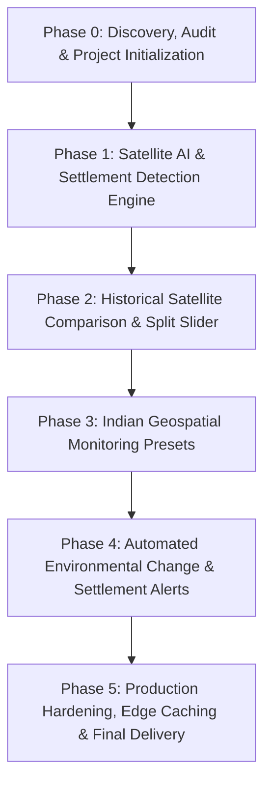

# ORBINEX — Development Phase Tracker

This document outlines the sequential roadmap, dependencies, status, and acceptance criteria for transforming ORBINEX into an AI-powered Geospatial Intelligence and Settlement Monitoring Platform.

---

## Roadmap Overview

---

## Detailed Phase Status

### Phase 0: Project Discovery, Architecture Audit & Rebranding
- **Status:** **COMPLETE / READY FOR REVIEW**
- **Prerequisites:** Clean extraction of baseline project.
- **Key Tasks:**
  - Complete repository audit of all 87 API routes, 53 components, and MapLibre engine.
  - Rebrand user-facing product identity to **ORBINEX** (*See the World. Understand the Change.*).
  - Eliminate endpoint latency bottlenecks (Reverse Geocoding 16s → 0.8s, Weather 7.2s → 3.6s, News 5.9s → 2.7s).
  - Implement Stale-While-Revalidate (SWR) and in-flight request deduplication.
  - Run regression test suite (1,506 passing tests).
- **Deliverables:**
  - `ORBINEX_PROJECT_AUDIT.md`
  - `ORBINEX_EXISTING_FEATURES.md`
  - `ORBINEX_TECHNICAL_ARCHITECTURE.md`
  - `ORBINEX_PHASE_TRACKER.md`
  - `ORBINEX_ARCHIVE_INVENTORY.md`
- **Acceptance Criteria:**
  - [x] Application compiles cleanly and runs on `http://localhost:3000`.
  - [x] No existing features, datasets, or layers removed.
  - [x] Full audit documents generated and presented.

---

### Phase 1: Satellite Imagery Retrieval & Raster Generation Engine
- **Status:** **COMPLETE & VERIFIED**
- **Dependencies:** Phase 0 completion.
- **Implemented Capabilities:**
  - Live STAC discovery pipeline against Element84 Earth Search v1 / Copernicus for Sentinel-2 L2A optical and Sentinel-1 GRD SAR.
  - Actual satellite image pixel retrieval from AWS S3 Cloud-Optimized GeoTIFFs (COG) and quicklook assets.
  - Python-based satellite raster processing engine (`src/lib/satellite/processor.py`) supporting spatial AOI cropping, 2%-98% percentile linear contrast stretching, and georeferenced PNG outputs.
  - Complete geospatial metadata sidecar preservation (EPSG:4326 CRS, resolution, cloud cover, sensor modality, and ESA Copernicus attribution).
  - Dedicated API endpoints: `/api/satellite/search`, `/api/satellite/process`, `/api/satellite/compare`, and `/api/satellite/asset`.
  - Enhanced `/api/sentinel` endpoint returning visual asset links, quad coordinates, and processing URLs.
  - Frontend interactive Satellite Intelligence panel (`SatelliteComparePanel.tsx`) with Indian strategic presets (Dhubri, Bengaluru, Western Ghats, Prayagraj), cloud filter, contrast stretch toggle, and MapLibre overlay integration.
  - 12 automated unit tests passing in `src/lib/satellite/satellite.test.ts`.
- **Acceptance Criteria Verified:**
  - [x] Real satellite observations found for supported AOIs and dates.
  - [x] Actual image pixels retrieved from authorized AWS S3 COG / quicklook providers.
  - [x] Imagery processed into valid PNG outputs with percentile contrast stretching.
  - [x] Generated image accurately corresponds to requested geographical area.
  - [x] Geospatial metadata sidecar (CRS, attribution, dimensions) preserved.
  - [x] Invalid AOIs, malformed dates, and SSRF attempts rejected.
  - [x] Existing application functionality and 87 API routes fully operational.

---

### Phase 2: Historical Satellite Comparison & Split-Screen Slider
- **Status:** **NEXT AUTHORIZED PHASE (PENDING USER APPROVAL)**
- **Dependencies:** Phase 1 completion.
- **Objectives:**
  - Synchronized dual-layer split-screen comparison slider on MapLibre ("Before vs After", e.g., Jan 2020 vs Jan 2024).
  - Swiping wipe interaction comparing two georeferenced satellite scenes.
  - Dynamic opacity and differential layer blending.
- **Acceptance Criteria:**
  - Users can smoothly swipe between historical and contemporary satellite captures of the same coordinates.

---

### Phase 3: Satellite AI & Settlement Detection Engine (YOLOv8 & SAHI)
- **Status:** **PENDING**
- **Dependencies:** Phase 2.
- **Objectives:**
  - Connect the YOLOv8 settlement and shelter detection engine (`RefugeeCampShelterDetection-YOLOv8-main`).
  - Implement Sliced Aided Hyper Inference (SAHI) for detecting small structures in high-resolution satellite tiles.
  - Build backend inference endpoint (`/api/geointel/detect`) to process imagery and return bounding boxes, class confidences (shelters, buildings, roads, clearings), and geo-referenced coordinates.
  - Add client-side visual overlay toggle to draw detected structures over satellite imagery.

---

### Phase 3: Indian Geospatial Monitoring Presets & AOI Catalog
- **Status:** **PENDING**
- **Dependencies:** Phase 2.
- **Objectives:**
  - Pre-configure high-priority monitoring regions in India:
    - *Assam / Dhubri Border Region* (Riverine chars, settlement expansion monitoring).
    - *Bengaluru Urban / Peri-Urban* (Rapid urbanization, lake bed encroachment, infrastructure expansion).
    - *Western Ghats & Protected Forests* (Forest-cover loss, road cutting).
  - Add one-click camera fly-to navigation for these strategic zones.
- **Acceptance Criteria:**
  - Selecting any pre-configured Indian monitoring region zooms smoothly and loads relevant historical satellite pairs.

---

### Phase 4: Automated Environmental Change & Settlement Alerts
- **Status:** **PENDING**
- **Dependencies:** Phase 3.
- **Objectives:**
  - Build automated difference calculation ($NDVI$ vegetation drop, building count delta, road network expansion).
  - Integrate alert generation into the existing `LiveAlerts` feed with severity classification.
  - Export structured intelligence reports in PDF and GeoJSON format for land management authorities.
- **Acceptance Criteria:**
  - When significant settlement expansion is detected in a monitored AOI, a structured alert appears in the Alerts drawer with supporting evidence metrics.

---

### Phase 5: Production Hardening, Edge Caching & Final Delivery
- **Status:** **PENDING**
- **Dependencies:** Phase 4.
- **Objectives:**
  - Performance profiling under heavy tile loads.
  - Docker containerization (`Dockerfile` and `docker-compose.yml` validation).
  - End-to-end regression testing and final documentation.
- **Acceptance Criteria:**
  - Zero memory leaks during extended globe spinning and tile swiping.
  - All existing OSIRIS feeds and new ORBINEX satellite AI layers operate seamlessly.
