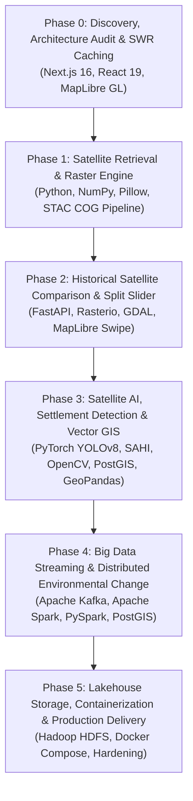

# ORBINEX — Development Phase Tracker

This document outlines the sequential roadmap, dependencies, status, technology assignments, and acceptance criteria for transforming ORBINEX into an enterprise-grade AI-powered Geospatial Intelligence, Big Data, and Settlement Monitoring Platform.

---

## Roadmap Overview

---

## Big Data & Geospatial Technology Phase Matrix

| Technology | Primary Ecosystem Role | Target Phase | Implementation Status |
| :--- | :--- | :--- | :--- |
| **Next.js 16 + React 19** | Core application frontend, SSR, API proxy layer | **Phase 0** | **COMPLETE & VERIFIED** |
| **MapLibre GL** | WebGL 2D/3D geospatial visualization & raster overlays | **Phase 0 / Phase 1** | **COMPLETE & VERIFIED** |
| **NumPy + Pillow** | Fast array operations & percentile contrast stretching | **Phase 1** | **COMPLETE & VERIFIED** |
| **STAC Client** | Earth Search v1 / Copernicus satellite asset discovery | **Phase 1** | **COMPLETE & VERIFIED** |
| **Python + FastAPI** | Dedicated geospatial raster & AI processing microservice | **Phase 2** | **NEXT AUTHORIZED PHASE** |
| **Rasterio + GDAL** | Geospatial raster I/O, reprojection, and multi-band arithmetic | **Phase 2** | **NEXT AUTHORIZED PHASE** |
| **PyTorch + SAHI** | Deep learning inference for settlement & shelter detection | **Phase 3** | Scheduled / Designed |
| **OpenCV** | Morphological filtering, contour extraction, edge detection | **Phase 3** | Scheduled / Designed |
| **PostgreSQL + PostGIS** | Spatial database, polygon indexing, geofencing, alert tables | **Phase 3 / Phase 4** | Scheduled / Designed |
| **GeoPandas + Shapely** | Vector geospatial analysis, polygon manipulation, reports | **Phase 3 / Phase 4** | Scheduled / Designed |
| **Apache Kafka** | Distributed event streaming bus for satellite intelligence events | **Phase 4** | Scheduled / Designed |
| **Apache Spark / PySpark** | Distributed batch raster processing & multi-temporal change | **Phase 4** | Scheduled / Designed |
| **Hadoop HDFS** | Distributed scale-out storage for multi-terabyte satellite lakehouse | **Phase 5** | Scheduled / Designed |
| **Docker + Docker Compose** | Multi-service container orchestration & deployment | **Phase 5** | Scheduled / Designed |

---

## Detailed Phase Status

### Phase 0: Project Discovery, Architecture Audit & Rebranding
- **Status:** **COMPLETE & VERIFIED**
- **Technologies:** Next.js 16, React 19, MapLibre GL, Node.js SWR in-memory caching.
- **Key Tasks:**
  - Complete repository audit of all 87 API routes, 53 components, and MapLibre engine.
  - Rebrand user-facing product identity to **ORBINEX** (*See the World. Understand the Change.*).
  - Eliminate endpoint latency bottlenecks (Reverse Geocoding 16s → 0.8s, Weather 7.2s → 3.6s, News 5.9s → 2.7s).
  - Implement Stale-While-Revalidate (SWR) and in-flight request deduplication.
  - Run regression test suite (1,506 passing tests).
- **Deliverables:**
  - `ORBINEX_PROJECT_AUDIT.md`
  - `ORBINEX_EXISTING_FEATURES.md`
  - `ORBINEX_TECHNICAL_ARCHITECTURE.md`
  - `ORBINEX_PHASE_TRACKER.md`
  - `ORBINEX_ARCHIVE_INVENTORY.md`
- **Acceptance Criteria Verified:**
  - [x] Application compiles cleanly and runs on `http://localhost:3000`.
  - [x] No existing features, datasets, or layers removed.
  - [x] Full audit documents generated and presented.

---

### Phase 1: Satellite Imagery Retrieval & Raster Generation Engine
- **Status:** **COMPLETE & CLOSED (VERIFIED)**
- **Technologies:** Python 3.11, NumPy, Pillow, Element84 STAC API, AWS S3 COG / Quicklook providers, MapLibre image layers, Komoot Photon / Nominatim Geocoding.
- **Implemented Capabilities:**
  - Live STAC discovery pipeline against Element84 Earth Search v1 / Copernicus for Sentinel-2 L2A optical and Sentinel-1 GRD SAR.
  - Actual satellite image pixel retrieval from AWS S3 Cloud-Optimized GeoTIFFs (COG) and quicklook assets.
  - Python-based satellite raster processing engine (`src/lib/satellite/processor.py`) supporting spatial AOI cropping, 2%-98% percentile linear contrast stretching, and georeferenced PNG outputs.
  - Automated JPEG-2000 (`.jp2`) to PNG server transcoding in `/api/satellite/asset` with SHA-256 caching, resolving historical (e.g. 2020) browser preview rendering.
  - Global Location Search engine: worldwide geocoding (`searchPlaces`), decimal coordinate parsing (`lat, lng`), suggestions dropdown, and real-time debouncing.
  - Dynamic AOI Telemetry HUD: live bounding box computation, $\approx 1,080\text{ km}^2$ Sentinel MGRS sub-tile area calculation, and MapLibre `onLocate` center alignment.
  - Complete geospatial metadata sidecar preservation (EPSG:4326 CRS, resolution, cloud cover, sensor modality, and ESA Copernicus attribution).
  - Dedicated API endpoints: `/api/satellite/search`, `/api/satellite/process`, `/api/satellite/compare`, and `/api/satellite/asset`.
  - Frontend interactive Satellite Intelligence panel (`SatelliteComparePanel.tsx`) with Indian strategic presets (Dhubri, Bengaluru, Western Ghats, Prayagraj), global location search, cloud filter, contrast stretch toggle, and MapLibre overlay integration.
  - 38 automated satellite unit tests passing (12 in `satellite.test.ts`, 16 in `satellite-layer.test.ts`, 3 in `satellite-programs.test.ts`, 6 in `phase1-audit.test.ts`, 1 in `report.test.ts`).
- **Acceptance Criteria Verified:**
  - [x] Real satellite observations retrieved for New York, London, Tokyo, Amazon Rainforest, Sahara Desert, Bengaluru, and decimal coordinates.
  - [x] Sentinel-1 SAR radar imagery verified globally (`sentinel-1-grd`).
  - [x] Actual image pixels retrieved from authorized AWS S3 COG / quicklook providers.
  - [x] Imagery processed into valid PNG outputs with percentile contrast stretching.
  - [x] Historical (2020) BEFORE images successfully transcode from JPEG-2000 and display without browser breakage.
  - [x] Generated image accurately corresponds to requested geographical area.
  - [x] Geospatial metadata sidecar (CRS, attribution, dimensions) preserved.
  - [x] Invalid AOIs, malformed dates, and SSRF attempts rejected.
  - [x] Existing application functionality, 17,000+ camera catalogue, and 87 API routes fully operational with zero regression.

---

### Phase 2: Historical Satellite Comparison & Split-Screen Slider
- **Status:** **NEXT AUTHORIZED PHASE (PENDING USER APPROVAL)**
- **Dependencies:** Phase 1 completion.
- **Technologies to Integrate:**
  - **FastAPI (Python):** Scaffolding dedicated high-concurrency microservice for image transforms and spatial alignment.
  - **Rasterio & GDAL:** Native multispectral COG reading, affine geospatial reprojection, and multi-band sub-setting.
  - **MapLibre GL:** Synchronized dual-layer split-screen comparison slider (`before` vs `after` georeferenced satellite scenes).
- **Objectives:**
  - Synchronized dual-layer split-screen comparison slider on MapLibre ("Before vs After", e.g., Jan 2020 vs Jan 2024).
  - Swiping wipe interaction comparing two georeferenced satellite scenes with pixel-perfect alignment.
  - Dynamic opacity, false-color (NIR/Red/Green) composite rendering, and differential layer blending.
- **Acceptance Criteria:**
  - Users can smoothly swipe between historical and contemporary satellite captures of the same coordinates with < 16ms frame latency.

---

### Phase 3: Satellite AI, Settlement Detection & Vector Spatial GIS
- **Status:** **SCHEDULED**
- **Dependencies:** Phase 2 completion.
- **Technologies to Integrate:**
  - **PyTorch:** Deep learning inference engine for settlement detection and land-use segmentation.
  - **YOLOv8 + SAHI (Sliced Aided Hyper Inference):** Small-object detection on gigapixel satellite tiles (detecting shelters, compounds, roads, vehicles).
  - **OpenCV:** Computer vision post-processing (morphological dilation, contour tracing, footprint boundary extraction).
  - **PostgreSQL & PostGIS:** Persistent spatial database with GiST indexing for fast bounding box spatial intersections and geofencing.
  - **GeoPandas & Shapely:** Vector geometry manipulation, polygon intersection, and structured GIS reporting.
- **Objectives:**
  - Build backend inference endpoint (`/api/geointel/detect`) returning verified structure counts, confidences, and GeoJSON bounding polygons.
  - Pre-configure high-priority Indian Strategic Presets:
    - *Assam / Dhubri Border Region* (Riverine char settlement monitoring).
    - *Bengaluru Urban / Peri-Urban* (Rapid urbanization, lake bed encroachment).
    - *Western Ghats & Protected Forests* (Forest-cover loss, road cutting).
  - Add client-side vector overlay toggle in MapLibre showing detected structures with confidence thresholds.
- **Acceptance Criteria:**
  - AI engine accurately detects building/shelter footprints and displays them as vector polygons overlaid on satellite scenes.

---

### Phase 4: Big Data Streaming & Distributed Environmental Change
- **Status:** **SCHEDULED**
- **Dependencies:** Phase 3 completion.
- **Technologies to Integrate:**
  - **Apache Kafka:** Distributed event streaming bus for real-time satellite telemetry, change detection events, and alert queuing.
  - **Apache Spark & PySpark:** Distributed cluster computing for batch multi-temporal $NDVI$, building delta matrices, and large-scale regional change analytics.
  - **PostGIS:** Historical alert ledgers, spatial change indexing, and time-series polygon diffs.
- **Objectives:**
  - Calculate multi-temporal change indices ($NDVI$ drop, new structure emergence rate, surface water shrinkage).
  - Stream detected change events through Kafka topics (`orbinex.satellite.change-events`).
  - Surface actionable alerts in the ORBINEX `LiveAlerts` panel with supporting statistical evidence.
  - Export formal intelligence dossiers in GeoJSON and PDF format.
- **Acceptance Criteria:**
  - Large-scale regional changes are processed via PySpark batch jobs and streamed into the live UI via Kafka-backed notifications.

---

### Phase 5: Lakehouse Storage, Containerization & Production Delivery
- **Status:** **SCHEDULED**
- **Dependencies:** Phase 4 completion.
- **Technologies to Integrate:**
  - **Hadoop HDFS:** Distributed scale-out file system for multi-terabyte raw satellite tiles and historical imagery lakehouse.
  - **Docker & Docker Compose:** Multi-service container orchestration (`nextjs`, `fastapi-geospatial`, `postgis`, `kafka`, `spark`, `hdfs`).
- **Objectives:**
  - Establish cold-tier historical satellite repository on HDFS with automated tiering.
  - Complete Docker Compose configuration for one-command multi-service deployment.
  - Production performance optimization, edge caching, and memory leak profiling.
- **Acceptance Criteria:**
  - Zero memory leaks during extended globe spinning and tile swiping.
  - All existing intelligence feeds (maritime, cameras, cyber) and new Big Data satellite AI layers operate in seamless harmony.
