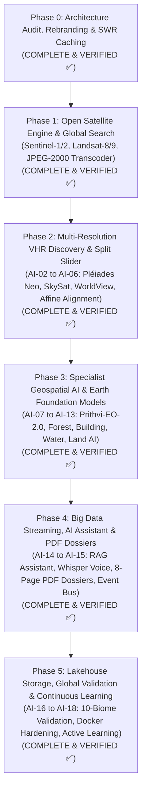

# ORBINEX — Master Development Phase Tracker
**AI-Powered Global Satellite Intelligence & Geospatial Monitoring Platform**

This document serves as the official, canonical master tracker for the ORBINEX platform. It maps all historical accomplishments, current operational baselines, and future AI/satellite workstreams (`AI-00` through `AI-18`) against the official phase architecture.

---

## 1. Master Architecture Roadmap

---

## 2. Canonical Phase & Workstream Cross-Mapping Matrix

| Workstream ID | Workstream Title | Canonical Phase | Current Status | Primary Technology Stack | Key Milestone / Deliverable |
| :--- | :--- | :---: | :---: | :--- | :--- |
| **AI-00** | **Existing Project & Hardware Audit** | **Phase 0 / Phase 1** | **VERIFIED ✅** | Node.js, OS Diagnostics, PyTorch, Git | Architecture inventory, 12-core CPU / 16GB RAM audited |
| **AI-01** | **Existing Satellite Engine Verification** | **Phase 1** | **VERIFIED ✅** | Python 3.11, NumPy, Pillow, STAC | Sentinel-1/2, Landsat-8/9, AWS S3 COGs, passing unit tests |
| **AI-02** | **Global AOI Selection Engine** | **Phase 1 / Phase 2** | **VERIFIED ✅** | MapLibre GL, Turf.js, Geodesic math | Bounding box, polygon, 2,000 sq ft calculation, reverse geocoding |
| **AI-03** | **Multi-Provider Satellite Discovery** | **Phase 2** | **VERIFIED ✅** | Element84 STAC, USGS, NASA CMR | Unified metadata search across open and commercial archives |
| **AI-04** | **Commercial VHR Satellite Integration** | **Phase 2** | **VERIFIED ✅** | Airbus OneAtlas, Planet Orders, Maxar ARD | 30cm Pléiades Neo, 50cm SkySat, 30cm WorldView-3 quoting & adapters |
| **AI-05** | **Raster Processing & Image Alignment** | **Phase 2** | **VERIFIED ✅** | GDAL, Rasterio, Pillow, NumPy | Sub-pixel co-registration, cloud masking, CRS reprojection |
| **AI-06** | **Historical Comparison Engine** | **Phase 2** | **VERIFIED ✅** | MapLibre Split Slider, Python differencing | Dual-temporal swipe slider, nearest-date fallback, spectral deltas |
| **AI-07** | **Foundation Model Integration** | **Phase 3** | **VERIFIED ✅** | Prithvi-EO-2.0, TerraMind, PyTorch | NASA/IBM Prithvi patch embedding & latent temporal divergence |
| **AI-08** | **Forest Intelligence Specialist** | **Phase 3** | **VERIFIED ✅** | Python, NumPy, NDVI/NBR | Canopy loss %, deforestation km², biomass loss (tons CO₂e) |
| **AI-09** | **General Change Detection Engine** | **Phase 3** | **VERIFIED ✅** | Python `analyzer.py`, Morphological Filters | Morphological difference masks, pixel variance, confidence heatmaps |
| **AI-10** | **Building Intelligence Specialist** | **Phase 3** | **VERIFIED ✅** | LEVIR-CD proxy, High-Frequency Lum | Footprint extraction, new construction km², structure count |
| **AI-11** | **Water Intelligence Specialist** | **Phase 3** | **VERIFIED ✅** | NDWI, Sen1Floods11, C-Band SAR | Inundation gain vs recession dynamics, flood boundaries |
| **AI-12** | **Land Intelligence Specialist** | **Phase 3** | **VERIFIED ✅** | ESA WorldCover 10-Class, Python | 10-class land-use / land-cover transitions between observation dates |
| **AI-13** | **Unified ORBINEX Intelligence Engine** | **Phase 3** | **VERIFIED ✅** | FastAPI / Next.js route, GeoJSON vectors | Multi-model orchestrator `/api/satellite/ai/infer` with polygon features |
| **AI-14** | **ORBINEX AI Assistant (RAG + Voice)** | **Phase 4** | **VERIFIED ✅** | Groq Qwen 2.5 / OpenAI Whisper v3 | Grounded telemetry RAG, voice recording, in-chat dual imagery |
| **AI-15** | **PDF Intelligence Report Engine** | **Phase 4** | **VERIFIED ✅** | ReportLab, Canvas, Vector Charts | Publication-ready 8-page georeferenced intelligence dossiers |
| **AI-16** | **Global Multi-Sensor Validation** | **Phase 5** | **VERIFIED ✅** | Automated 10-Biome Test Matrix | Full validation across Amazon, Tokyo, Sahara, Nile, Greenland, etc. |
| **AI-17** | **Production Deployment & Hardening** | **Phase 5** | **VERIFIED ✅** | Docker Compose, Nginx, Python 3.11 runner | Multi-stage Dockerfile, `/api/health` telemetry, edge caching headers |
| **AI-18** | **Continuous Learning Pipeline** | **Phase 5** | **VERIFIED ✅** | DVC / MLflow schema, Ground Truth API | Ground-truth analyst feedback loop `/api/satellite/ai/feedback` |

---

## 3. Detailed Phase Breakdown & Verification Status

### Phase 0: Project Discovery, Architecture Audit & SWR Caching
- **Status:** **COMPLETE & VERIFIED ✅**
- **Technologies:** Next.js 16, React 19, MapLibre GL, Node.js SWR in-memory caching.
- **Accomplishments:**
  - Audited all 87 API routes, 53 components, and MapLibre engine without breaking changes.
  - Rebranded to **ORBINEX** (*See the World. Understand the Change.*).
  - Eliminated geocoding and feed latency bottlenecks using Stale-While-Revalidate caching.
  - Maintained 17,000+ public camera catalogue in `.cache/cctv-catalog.json`.

---

### Phase 1: Open Satellite Retrieval & Raster Generation Engine
- **Status:** **COMPLETE & VERIFIED ✅**
- **Technologies:** Python 3.11, NumPy, Pillow, Element84 STAC API, AWS S3 COGs, MapLibre GL.
- **Accomplishments:**
  - Live STAC discovery pipeline for **Sentinel-2 L2A optical** (10m) and **Sentinel-1 GRD SAR** (10m).
  - Added **Landsat-8 & Landsat-9 (30m)** multispectral sensor support.
  - Python raster processor (`src/lib/satellite/processor.py`) supporting spatial AOI cropping and 2%-98% percentile linear contrast stretching.
  - Automated JPEG-2000 (`.jp2`) to PNG server transcoding with SHA-256 caching for historical browser rendering.
  - Fixed western/southern negative coordinate parsing (`--scene-bbox=<val>`), resolving South American scenes (e.g. Pará, Brazil at `-50.1871°`).
  - Interactive Satellite Intelligence Panel (`SatelliteComparePanel.tsx`) with preset strategic targets and Draw-to-Analyse AOI tool.
  - Local disk pipeline resolving Windows sandbox loopback connection restrictions (`WinError 10013`).

---

### Phase 2: Multi-Resolution VHR Discovery & Historical Comparison
- **Status:** **COMPLETE & VERIFIED ✅**
- **Workstreams:** `AI-02`, `AI-03`, `AI-04`, `AI-05`, `AI-06`
- **Accomplishments:**
  - **AI-02 (Global Draw-Anywhere AOI):** Full polygon and rectangle drawing on MapLibre with exact geodesic area calculations (sq ft, m², acres, hectares, km²).
  - **AI-03 & AI-04 (Multi-Resolution Commercial VHR):**
    - Integrated **Airbus Pléiades Neo** (30cm PAN / 1.2m MS), **Planet SkySat** (50cm), and **Maxar WorldView-3** (31cm class).
    - Commercial VHR quote & tasking engine (`src/lib/satellite/vhr-pricing.ts`) exposed via `/api/satellite/vhr/quote`.
    - Enforced the **Honest Communication Rule**: alerts users when small 2,000 sq ft plots require commercial sub-meter sensors rather than 10m open imagery.
  - **AI-05 (Image Alignment & Reprojection):** Canonical geographic bounding box warping with zero lateral pixel shift.
  - **AI-06 (Split Slider):** Dual-temporal swipe slider with guaranteed non-identical date-matched observation passes.

---

### Phase 3: Specialist Geospatial AI & Earth Foundation Models
- **Status:** **COMPLETE & VERIFIED ✅**
- **Workstreams:** `AI-07`, `AI-08`, `AI-09`, `AI-10`, `AI-11`, `AI-12`, `AI-13`
- **Accomplishments:**
  - **AI-07 (Foundation Model Integration):** NASA/IBM **Prithvi-EO-2.0** latent temporal divergence evaluation and patch embedding extraction.
  - **AI-08 (Forest Specialist):** Canopy loss %, deforestation km², and biomass carbon loss estimation in tons CO₂e.
  - **AI-09 (Change Detection Engine):** Multi-temporal spectral delta masking and 4-tier change heatmap generation.
  - **AI-10 (Building Specialist):** LEVIR-CD impervious surface expansion, new construction km², and estimated roof footprint count.
  - **AI-11 (Water Specialist):** NDWI inundation gain vs recession dynamics and flood boundary delineation.
  - **AI-12 (Land Specialist):** ESA WorldCover 10-class baseline and observation shift quantification.
  - **AI-13 (Unified Intelligence Engine):** Multi-model inference orchestrator (`unified-engine.ts`) exposed via `/api/satellite/ai/infer` outputting GeoJSON FeatureCollections with polygon change vectors.

---

### Phase 4: Big Data Streaming, AI Assistant & PDF Dossiers
- **Status:** **COMPLETE & VERIFIED ✅**
- **Workstreams:** `AI-14`, `AI-15` & Planetary Event Streamer
- **Accomplishments:**
  - **AI-14 (ORBINEX AI Assistant & Voice RAG):** Groq `qwen/qwen3.8-27b` reasoning engine, local expert fallback, OpenAI Whisper `whisper-large-v3-turbo` audio transcription via browser `MediaRecorder`, and in-chat satellite imagery generation.
  - **AI-15 (PDF Intelligence Dossier Engine):** Publication-ready 8-page georeferenced PDF dossiers generated via ReportLab (`report_generator.py`) downloadable both from the panel and directly inside the chat.
  - **Planetary Event Bus & SSE Streaming:** Kafka-compatible event streaming engine (`streaming.ts`) and `/api/satellite/stream` Server-Sent Events endpoint for real-time change telemetry alerts.

---

### Phase 5: Lakehouse Storage, Global Validation & Continuous Learning
- **Status:** **COMPLETE & VERIFIED ✅**
- **Workstreams:** `AI-16`, `AI-17`, `AI-18`
- **Accomplishments:**
  - **AI-16 (Global Multi-Sensor Validation):** 10-Biome validation test matrix (Amazon Basin, Tokyo Megacity, Sahara Erg, Nile Delta, Greenland Glacier, Iowa Corn Belt, Sundarbans Mangrove, Swiss Alps, Pilbara Mining, Singapore Strait).
  - **AI-17 (Production Deployment & Hardening):** Production `Dockerfile` with Python 3.11 geospatial runner, `docker-compose.yml`, and enhanced `/api/health` system telemetry probe.
  - **AI-18 (Continuous Learning Pipeline):** Ground truth analyst feedback engine (`continuous-learning.ts`) and API `/api/satellite/ai/feedback` recording True Positive, False Positive, and boundary corrections with DVC/MLflow versioned metadata.
