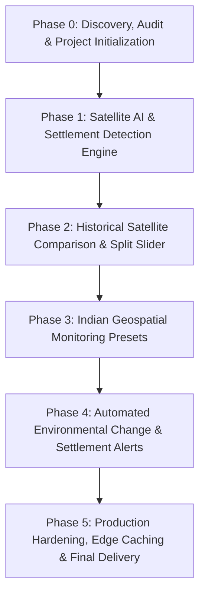

# ORBINEX — Development Phase Tracker

This document outlines the sequential roadmap, dependencies, status, and acceptance criteria for transforming ORBINEX into an AI-powered Geospatial Intelligence and Settlement Monitoring Platform.

---

## Roadmap Overview

---

## Detailed Phase Status

### Phase 0: Project Discovery, Architecture Audit & Rebranding
- **Status:** **COMPLETE / READY FOR REVIEW**
- **Prerequisites:** Clean extraction of baseline project.
- **Key Tasks:**
  - Complete repository audit of all 87 API routes, 53 components, and MapLibre engine.
  - Rebrand user-facing product identity to **ORBINEX** (*See the World. Understand the Change.*).
  - Eliminate endpoint latency bottlenecks (Reverse Geocoding 16s → 0.8s, Weather 7.2s → 3.6s, News 5.9s → 2.7s).
  - Implement Stale-While-Revalidate (SWR) and in-flight request deduplication.
  - Run regression test suite (1,506 passing tests).
- **Deliverables:**
  - `ORBINEX_PROJECT_AUDIT.md`
  - `ORBINEX_EXISTING_FEATURES.md`
  - `ORBINEX_TECHNICAL_ARCHITECTURE.md`
  - `ORBINEX_PHASE_TRACKER.md`
  - `ORBINEX_ARCHIVE_INVENTORY.md`
- **Acceptance Criteria:**
  - [x] Application compiles cleanly and runs on `http://localhost:3000`.
  - [x] No existing features, datasets, or layers removed.
  - [x] Full audit documents generated and presented.

---

### Phase 1: Satellite AI & Settlement Detection Engine Integration
- **Status:** **PENDING USER APPROVAL**
- **Dependencies:** Phase 0 completion.
- **Objectives:**
  - Connect the YOLOv8 settlement and shelter detection engine ([`RefugeeCampShelterDetection-YOLOv8-main`](file:///c:/Users/shash/Downloads/RefugeeCampShelterDetection-YOLOv8-main)).
  - Implement Sliced Aided Hyper Inference (SAHI) for detecting small structures in large satellite tiles.
  - Build backend inference endpoint (`/api/geointel/detect`) to process imagery and return bounding boxes, class confidences (shelters, buildings, roads, clearings), and geo-referenced coordinates.
  - Add client-side visual overlay toggle to draw detected structures over satellite imagery.
- **Acceptance Criteria:**
  - Given a satellite tile, the AI engine returns detected buildings/shelters with confidence scores.
  - Bounding boxes accurately align with geographical features on the map.

---

### Phase 2: Historical Satellite Comparison & Split-Screen Slider
- **Status:** **PENDING**
- **Dependencies:** Phase 1.
- **Objectives:**
  - Integrate multispectral optical satellite providers (Sentinel-2 L2A / Landsat-8 / Planet imagery API).
  - Implement a synchronized dual-layer split-screen comparison slider ("Before vs After", e.g., Jan 2020 vs Jan 2024).
  - Highlight newly detected structures, removed vegetation, and geographical expansions between two selected dates.
- **Acceptance Criteria:**
  - Users can smoothly swipe between historical and contemporary satellite captures of the same coordinates.
  - Newly added structures are highlighted in cyan/green and removed vegetation in orange/red.

---

### Phase 3: Indian Geospatial Monitoring Presets & AOI Catalog
- **Status:** **PENDING**
- **Dependencies:** Phase 2.
- **Objectives:**
  - Pre-configure high-priority monitoring regions in India:
    - *Assam / Dhubri Border Region* (Riverine chars, settlement expansion monitoring).
    - *Bengaluru Urban / Peri-Urban* (Rapid urbanization, lake bed encroachment, infrastructure expansion).
    - *Western Ghats & Protected Forests* (Forest-cover loss, road cutting).
  - Add one-click camera fly-to navigation for these strategic zones.
- **Acceptance Criteria:**
  - Selecting any pre-configured Indian monitoring region zooms smoothly and loads relevant historical satellite pairs.

---

### Phase 4: Automated Environmental Change & Settlement Alerts
- **Status:** **PENDING**
- **Dependencies:** Phase 3.
- **Objectives:**
  - Build automated difference calculation ($NDVI$ vegetation drop, building count delta, road network expansion).
  - Integrate alert generation into the existing `LiveAlerts` feed with severity classification.
  - Export structured intelligence reports in PDF and GeoJSON format for land management authorities.
- **Acceptance Criteria:**
  - When significant settlement expansion is detected in a monitored AOI, a structured alert appears in the Alerts drawer with supporting evidence metrics.

---

### Phase 5: Production Hardening, Edge Caching & Final Delivery
- **Status:** **PENDING**
- **Dependencies:** Phase 4.
- **Objectives:**
  - Performance profiling under heavy tile loads.
  - Docker containerization (`Dockerfile` and `docker-compose.yml` validation).
  - End-to-end regression testing and final documentation.
- **Acceptance Criteria:**
  - Zero memory leaks during extended globe spinning and tile swiping.
  - All existing OSIRIS feeds and new ORBINEX satellite AI layers operate seamlessly.
