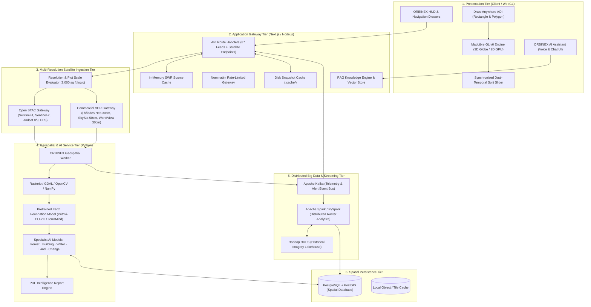
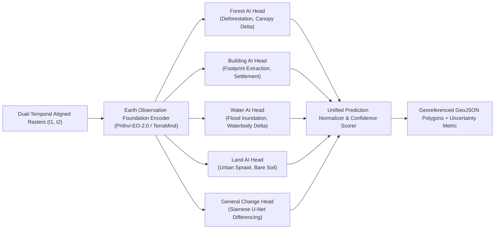
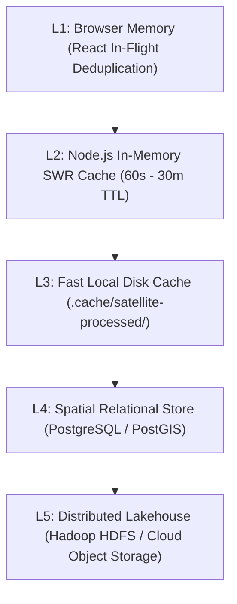

# ORBINEX — Technical Architecture Documentation
**Enterprise Multi-Resolution Geospatial Intelligence & Scalable Big Data Architecture**

This document describes the architectural layout, data flow, rendering pipelines, component hierarchy, multi-resolution satellite adapters, and the scalable **Big Data and AI ecosystem** powering the ORBINEX platform.

---

## 1. System Architecture Overview

ORBINEX implements a hybrid, decoupled architecture across 6 core tiers:
* **Presentation Tier:** Next.js 16 (App Router), React 19, and MapLibre GL v6 WebGL/WebGPU rendering engine with Split Comparison Slider and Drawing AOI tools.
* **API Gateway & Core Server:** Next.js Node.js server handling 87 intelligence routes, in-flight deduplication, and SWR caching.
* **Multi-Resolution Satellite Ingestion Tier:** Unified `SatelliteProviderAdapter` coordinating Open STAC (Sentinel-1/2, Landsat-8/9, HLS) and Commercial VHR APIs (Airbus Pléiades Neo 30cm, Planet SkySat 50cm, Maxar WorldView-3 30cm).
* **Geospatial Processing & AI Worker:** Python worker executing raster georeferencing, affine projection, JPEG-2000 transcoding, and deep learning inference with pretrained Earth foundation models.
* **Distributed Big Data Engine:** Apache Spark & PySpark for planetary-scale raster computation, Apache Kafka for event-driven telemetry, and Hadoop HDFS for multi-temporal satellite archives.
* **Geospatial Data Store:** PostgreSQL with PostGIS extension for spatial vector queries and indexing.

---

## 2. Multi-Resolution Hierarchy & Analytical Limits

ORBINEX enforces clear physical distinctions between open-access satellite data and commercial sub-meter imagery:

| Sensor Class | Constellation | GSD | Approx Pixels on 2,000 sq ft ($186\text{ m}^2$) | Primary Use Case | Honest System Policy |
| :--- | :--- | :---: | :---: | :--- | :--- |
| **Tier 1: Global Open** | Sentinel-2 L2A | 10 m | **~2 pixels** | Regional vegetation ($NDVI$), water extent, broad land cover | System warns user: *Plot is too small for internal change verification.* |
| **Tier 1: All-Weather Radar** | Sentinel-1 GRD | 10 m | **~2 pixels** | Cloud-penetrating flood detection, surface backscatter changes | Radar speckle prevents plot-level inspection. |
| **Tier 1: Historical Baseline**| Landsat 8/9 | 30 m | **~0.2 pixels** | Decadal climate monitoring, broad regional change baselines | Sub-pixel plot. |
| **Tier 2: High-Resolution** | Planet SkySat | 50 cm | **~744 pixels** | Infrastructure detection, building boundaries, parking lots | Commercial archive / tasking required. |
| **Tier 3: Very High Res (VHR)**| Airbus Pléiades Neo| 30 cm PAN | **~2,067 pixels** | Small-area visual monitoring, building footprints, site excavation | Explicit distinction: 30cm PAN vs 1.2m multispectral color. |
| **Tier 4: Premium VHR** | Maxar WorldView-3 | 31 cm PAN | **~1,939 pixels** | Sub-meter structural inspection, high-accuracy defense GIS | Premium licensing. |

---

### 2.1 Professional Satellite Comparison Viewer Architecture (AI-06)

ORBINEX features an integrated multi-mode satellite imagery comparison viewer (`ProfessionalComparisonViewer.tsx`) designed for sub-pixel change inspection across multi-temporal and multi-resolution acquisitions:

1. **Interactive Swipe Mode:**
   - Single synchronized canvas with a draggable vertical divider line.
   - Hardware-accelerated CSS `clip-path: inset(0 ${100 - sliderPos}% 0 0)` revealing the historical baseline against the contemporary pass.
   - Touch and pointer-capture binding to prevent sticky dragging or unintentional map panning.
   - Keyboard accessibility (`ArrowLeft`/`ArrowRight` at 2% increments; Shift+Arrow at 10%; `Home`/`End` for 0%/100%).

2. **Side-by-Side Synchronized Mode:**
   - Dual equal-sized viewports showing BEFORE and AFTER scenes simultaneously.
   - **Unified Viewport State:** Both viewports are driven by a single canonical transform `{ zoom: 1.0..8.0, panX, panY }`, guaranteeing frame-perfect synchronization with zero recursive event loops.
   - Independent viewport telemetry badges showing acquisition date, sensor modality, native GSD, and provider.

3. **Split/Overlay Mode (Fader & Flicker):**
   - Continuous opacity slider (0% to 100%) for gradual layer cross-fading.
   - **High-Frequency Flicker/Blink (2Hz):** Alternates between epochs to instantly highlight new building footprints, ground clearance, and shifted shoreline edges.
   - **Spectral Difference Blend (`mix-blend-mode: difference`):** Cancels identical pixels and vividly illuminates surface transitions.

4. **Multi-Resolution GSD Engine (`comparison-specs.ts`):**
   - Automatically computes resolution asymmetry ratios between paired sensors (e.g. 10m Sentinel-2 vs 0.5m SkySat = $20.0\times$ ratio).
   - Surfaces honest telemetry warnings stating that both sensors are projected onto a common comparison grid without synthetic upscaling.
   - Clamps geographic viewport panning based on current zoom level to prevent imagery from disappearing beyond canvas boundaries.

---

## 3. Specialist AI Models & Foundation Architecture

ORBINEX does **not** train foundation models from scratch. It employs a **Hybrid Pretrained + Specialist Model Architecture**:

### Specialist Model Focus Areas:
1. **Forest Intelligence Model:** Trained on BioMassters / HLS Burn Scars; outputs deforestation probability, canopy reduction percentage, and burn scars.
2. **Building Intelligence Model:** Fine-tuned on LEVIR-CD and S2Looking for structural footprint emergence, construction grading, and settlement boundaries.
3. **Water Intelligence Model:** Fine-tuned on Sen1Floods11; combines Sentinel-1 SAR and optical bands to delineate floodlines and riverbank recession.
4. **Land Intelligence Model:** Based on ESA WorldCover; monitors agricultural conversions and urban expansion.
5. **General Change Detection Model:** Uses Siamese difference architectures to isolate anomalous geometric and radiometric variances with confidence scores.

---

## 4. Storage & Caching Hierarchy

1. **L1 (Browser Memory):** In-flight deduplication prevents redundant network calls during rapid pan/zoom interactions.
2. **L2 (Node.js SWR):** High-speed in-memory cache for live intelligence feeds (news, earthquakes, weather, flights).
3. **L3 (Local Disk Cache):** SHA-256 hashed `.png` rasters, transcoded JPEG-2000 assets, and `.meta.json` telemetry sidecars.
4. **L4 (PostgreSQL + PostGIS):** Persists monitored AOIs, historical detection logs, alert histories, and geospatial spatial indexes (`GIST`).
5. **L5 (Hadoop HDFS):** Scalable, distributed cluster storage for high-volume raw satellite archives (Sentinel-1/2 L1C/L2A COGs, Landsat-8/9 archives).

---

## 5. Security & Isolation Boundaries

1. **SSRF Guard:** All satellite and external URLs are strictly validated against an approved hostname allowlist (`isAllowedSatelliteUrl`), blocking private RFC 1918 IPs, cloud metadata endpoints (`169.254.169.254`), and loopback addresses.
2. **Deterministic Geofencing:** Coordinate queries are sanitized and clamped to valid WGS84 bounds before execution.
3. **Responsible AI Boundary:** Satellite AI models identify physical objects only (structures, roads, water, vegetation canopy); demographic, nationality, or immigration profiling is structurally blocked.
4. **No-Hallucination Assistant Rule:** The RAG-powered AI assistant answers queries strictly from verified satellite metadata, bounding coordinates, and analysis outputs. It never invents observations or dates.
