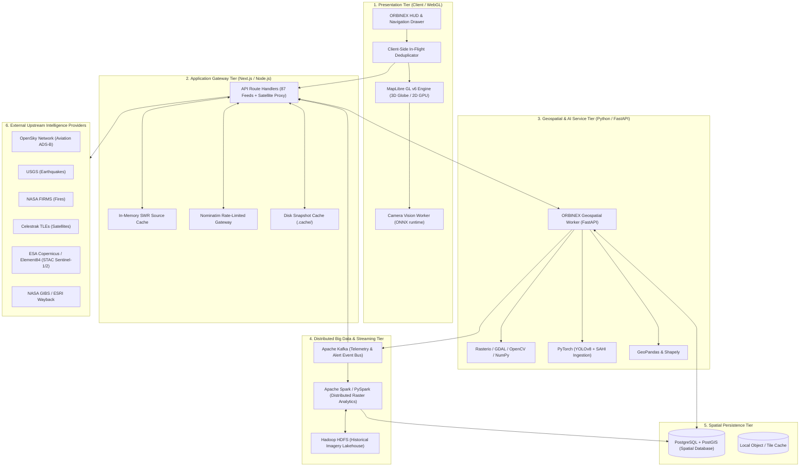
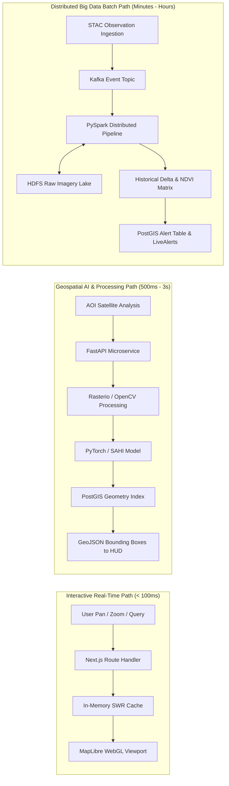
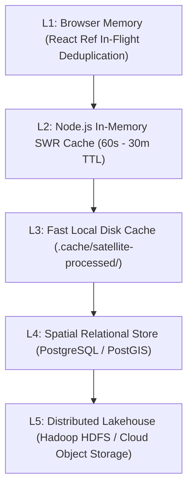

# ORBINEX — Technical Architecture Documentation
**Enterprise Geospatial Intelligence & Scalable Big Data Architecture**

This document describes the architectural layout, data flow, rendering pipelines, component hierarchy, and the scalable **Big Data ecosystem** powering the ORBINEX platform.

---

## 1. System Architecture Overview

ORBINEX implements a hybrid, decoupled architecture:
* **Presentation Tier:** Next.js 16 (App Router), React 19, and MapLibre GL v6 WebGL/WebGPU rendering engine.
* **API Gateway & Core Server:** Next.js Node.js server handling 87 intelligence routes, in-flight deduplication, and SWR caching.
* **Geospatial Processing & AI Worker:** Python FastAPI service executing raster georeferencing, multispectral processing, and deep learning inference.
* **Distributed Big Data Engine:** Apache Spark & PySpark for planetary-scale raster computation, Apache Kafka for event-driven telemetry, and Hadoop HDFS for multi-temporal satellite archives.
* **Geospatial Data Store:** PostgreSQL with PostGIS extension for spatial vector queries and indexing.

---

## 2. Technology Stack & Role Matrix

To ensure architectural integrity, each technology in the Big Data ecosystem has a dedicated, non-overlapping responsibility:

| Component | Technology | Primary Function | Roadmap Phase |
| :--- | :--- | :--- | :---: |
| **Frontend HUD** | **Next.js 16 + React 19** | User interface, telemetry display, interactive drawers, and controls. | Phase 0–5 |
| **Map Engine** | **MapLibre GL v6** | GPU-accelerated 3D globe and 2D map visualization, raster/vector overlays. | Phase 0–5 |
| **Raster Engine** | **Rasterio, GDAL, OpenCV, NumPy** | Georeferencing, affine projection, band stacking (RGB/NIR), contrast stretching. | Phase 1–3 |
| **Microservice** | **Python & FastAPI** | High-throughput asynchronous service for heavy raster processing and tile generation. | Phase 2–3 |
| **Satellite AI** | **PyTorch (YOLOv8 + SAHI)** | Deep learning inference for settlement detection, building footprinting, canopy loss. | Phase 3 |
| **Spatial Database** | **PostgreSQL + PostGIS** | Spatial indexing (`R-Tree`), polygonal AOI storage, geofencing, alert persistence. | Phase 3–4 |
| **Vector Analytics**| **GeoPandas & Shapely** | Vector geometry operations, boundary intersections, and GeoJSON report compilation. | Phase 3–4 |
| **Event Streaming** | **Apache Kafka** | Real-time event bus for satellite pass alerts, detection notifications, and feed ingest. | Phase 4 |
| **Batch Analytics** | **Apache Spark & PySpark**| Distributed tile mosaicking, multi-temporal NDVI change analysis over large states. | Phase 4–5 |
| **Distributed Lake**| **Hadoop HDFS** | Long-term distributed storage for multi-terabyte raw satellite archives. | Phase 4–5 |
| **Containerization**| **Docker & Compose** | Containerized orchestration of Next.js, FastAPI, PostGIS, Kafka, and Spark workers. | Phase 5 |

---

## 3. Data Processing Pathways

The architecture separates data operations into three distinct latency tiers to avoid introducing heavy Big Data overhead where lightweight solutions suffice:

### Architectural Justification Rules:
1. **Lightweight First:** Single scene visual lookups, catalog STAC searches, and localized map zooms use the lightweight Next.js $\leftrightarrow$ SWR pathway without waking the Big Data cluster.
2. **FastAPI for Heavy Geometry:** When image manipulation (clipping, contrast stretching, PyTorch model execution) is required, the request delegates to the Python FastAPI worker.
3. **Kafka & Spark for Scale Only:** Apache Kafka and Apache Spark are triggered strictly for:
   - Automated ingestion of entire satellite passes across thousands of square kilometers.
   - Batch temporal diffing across 5+ years of historical imagery.
   - Multi-node distributed change analytics.

---

## 4. Storage & Caching Hierarchy

1. **L1 (Browser Memory):** In-flight deduplication prevents duplicate network requests during rapid camera movement or component re-renders.
2. **L2 (Node.js SWR):** High-speed in-memory store for upstream feeds (weather, news, flight decimation, satellite TLEs).
3. **L3 (Local SSD Cache):** Deterministic SHA-256 hashed PNGs and metadata sidecars generated by the raster processing engine.
4. **L4 (PostgreSQL + PostGIS):** Persists monitored AOIs, historical detection logs, alert histories, and geospatial spatial indexes (`GIST`).
5. **L5 (Hadoop HDFS):** Scalable, distributed cluster storage for high-volume raw satellite archives (Sentinel-1/2 L1C/L2A COGs, Landsat-8/9 archives).

---

## 5. Security & Isolation Boundaries

1. **Air-Gapped Processing Isolation:** The Python FastAPI raster and PyTorch engine operates behind internal network boundaries; public clients interact exclusively with Next.js API routes.
2. **SSRF Guard:** All satellite asset ingestion is strictly verified against an approved host allowlist (`isAllowedSatelliteUrl`), blocking internal loopback IPs, cloud metadata (`169.254.169.254`), and arbitrary endpoints.
3. **PostGIS Geofencing:** Coordinate queries are sanitized and clamped to valid WGS84 bounds before execution in spatial SQL queries.
4. **Responsible AI Boundary:** The PyTorch detection pipeline is restricted strictly to observable physical geographical indicators (structures, roads, water bodies, tree canopy), rejecting demographic classification.
