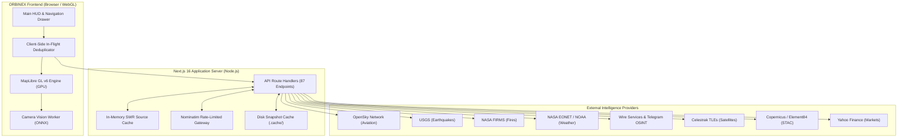
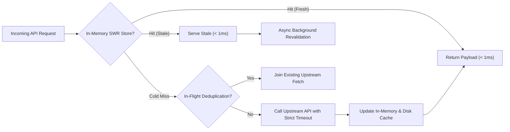

# ORBINEX — Technical Architecture Documentation

This document describes the architectural layout, data flow, rendering pipelines, and component hierarchy of the ORBINEX geospatial platform.

---

## 1. System Architecture Overview

---

## 2. Rendering Pipeline & GPU Offloading

ORBINEX renders large datasets without browser stuttering through a pure WebGL GPU architecture:

1. **MapLibre GL Vector Pipeline:**
   - Map points are never injected into the React DOM tree as `HTMLDivElement` markers.
   - All layers (flights, earthquakes, satellites, CCTV, fires, storm polygons) are declared as MapLibre GeoJSON sources.
   - Data is batched and rendered using GPU vertex shaders (`circle`, `line`, `symbol`, `fill-extrusion`).
2. **Flight Decimation Worker:**
   - Global aviation datasets containing 10,000+ points are decimated by a factor of 10 for commercial flights and factor of 2 for private flights.
3. **CCTV Preview Virtualization:**
   - Snapshot preview cards only bind to the DOM when map zoom is `≥ 13`.
   - Capped at maximum 8 preview tiles and 4 concurrent video decodes.

---

## 3. Data Ingestion & Caching Hierarchy

### Caching Layers
1. **L1: Browser Memory / React Ref Deduplication:**
   - In-flight Promise map in `page.tsx` prevents duplicate HTTP requests when multiple components mount.
2. **L2: Node.js In-Memory SWR Cache (`src/lib/sourceCache.ts`):**
   - Configurable TTLs (60s to 30m) with background revalidation.
3. **L3: Persistent Disk Snapshots (`.cache/`):**
   - Stores CCTV indexes and reverse geocode responses so server restarts do not re-query rate-limited upstreams.
4. **L4: Upstream Rate Limiting (`src/lib/nominatim.ts`):**
   - Enforces a 2-second rate-limit gap and strict 1.5s timeout guards.

---

## 4. Component Hierarchy

- **Root Layout (`src/app/layout.tsx`):**
  - Font definitions, metadata headers, theme providers.
- **Main View (`src/app/page.tsx`):**
  - **`OsirisMap.tsx`:** Primary WebGL container, handles layer styling, camera movements, coordinate hooks, and click events.
  - **`GlobalStatusBar.tsx`:** Top telemetry HUD bar.
  - **`LayerPanel.tsx`:** Slide-out drawer with toggles for all 15+ intelligence layers.
  - **`LiveAlerts.tsx`:** Chronological breaking news and high-priority incident feed.
  - **`MarketsPanel.tsx`:** Financial markets and maritime chokepoints overview.
  - **`DrawingToolbar.tsx`:** Spatial AOI drawing and feature filtering.
  - **`CameraViewer.tsx`:** Live CCTV player modal with ONNX object detector.
  - **`AiOverview.tsx`:** Gemini situation analysis modal.
