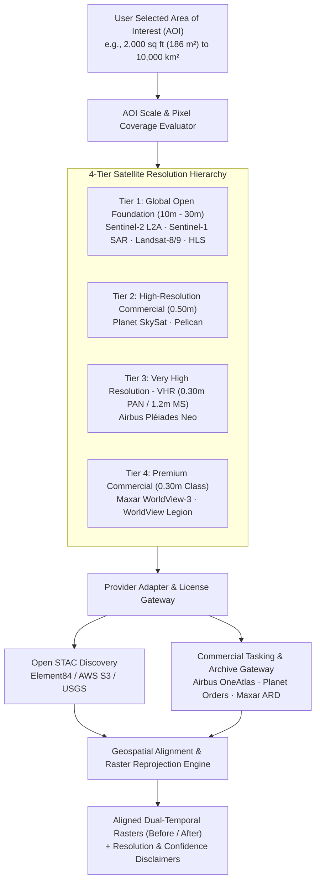

# ORBINEX — Multi-Resolution & Very High Resolution (VHR) Satellite Architecture
**Authoritative Architectural Specification for Global & Small-Area Earth Observation**

---

## 1. Executive Strategy: Hybrid Multi-Resolution Engine

ORBINEX does **not** replace Sentinel-1 and Sentinel-2. Instead, it implements a **Hybrid Multi-Resolution Satellite Intelligence Platform** that harmonizes global open-access constellations with commercial Very High Resolution (VHR) satellites under a unified, provider-agnostic abstraction layer.



---

## 2. Multi-Resolution Hierarchy & Use Case Matrix

| Tier | Satellite Platform | Ground Sample Distance (GSD) | Spectral Modality | Primary Intelligence Purpose | Cost & Licensing |
| :--- | :--- | :--- | :--- | :--- | :--- |
| **Tier 1 (Open)** | **Sentinel-2A/B** | **10m** (Visible/NIR), 20m (RedEdge/SWIR) | 13-Band Multispectral | Regional vegetation ($NDVI$), deforestation, water bodies, wildfire scars | Free / Open Access (ESA Copernicus) |
| **Tier 1 (Open)** | **Sentinel-1A/C** | **10m** (GRD IW) | C-Band Synthetic Aperture Radar (SAR) | All-weather surface disturbance, flood extents, ship detection through clouds | Free / Open Access (ESA Copernicus) |
| **Tier 1 (Open)** | **Landsat 8/9** | **30m** (Multispectral), 15m (PAN) | 11-Band Multispectral + Thermal | Long-term historical baselines (1984–present), climate change, agricultural monitoring | Free / Open Access (USGS / NASA) |
| **Tier 2 (High-Res)** | **Planet SkySat / Pelican** | **~50 cm** (0.50m) | 4-Band Multispectral (RGB+NIR) + PAN | Detailed urban infrastructure, port container counting, industrial facility changes | Commercial API key / Archive quota required |
| **Tier 3 (VHR)** | **Airbus Pléiades Neo** | **30 cm PAN**, **1.2m Multispectral** | 6-Band (Deep Blue, Blue, Green, Red, RedEdge, NIR) | Small-area visual monitoring, building footprint detection, construction changes | Commercial License (Airbus OneAtlas) |
| **Tier 4 (Premium)** | **Maxar WorldView-3 / Legion** | **30 cm Class** (0.31m PAN, 1.24m MS) | 8-Band Visible/NIR + 8-Band SWIR + 12 CAVIS | Defense-grade geospatial intelligence, sub-meter feature extraction, infrastructure assessment | Commercial License (Maxar ARD / SecureWatch) |

---

## 3. Small-Area Analysis Specification (The 2,000 sq ft Plot Benchmark)

### 3.1 Mathematical Reality of 2,000 sq ft (186 m²)
Detecting a 2,000 sq ft property ($14\text{ m} \times 13.3\text{ m} \approx 186.2\text{ m}^2$) is fundamentally constrained by the Ground Sample Distance (GSD) of the observing sensor:

$$\text{Pixel Area} = \text{GSD} \times \text{GSD}$$
$$\text{Pixels Covering Plot} \approx \frac{186\text{ m}^2}{\text{Pixel Area}}$$

| Satellite Platform | Nominal Resolution | Single Pixel Area | Approximate Pixels on 2,000 sq ft Plot | Analytical Viability on 2,000 sq ft |
| :--- | :--- | :--- | :--- | :--- |
| **Sentinel-2 Optical** | 10 m | $100\text{ m}^2$ | **~1.86 pixels** | **UNSUITABLE for internal change.** Can only detect if regional color/NDVI shifted. |
| **Sentinel-1 SAR** | 10 m | $100\text{ m}^2$ | **~1.86 pixels** | **UNSUITABLE.** Dominated by speckle and mixed backscatter. |
| **Landsat 8/9** | 30 m | $900\text{ m}^2$ | **~0.21 pixels** | **UNSUITABLE.** Plot is sub-pixel noise. |
| **Planet SkySat** | 50 cm ($0.5\text{ m}$) | $0.25\text{ m}^2$ | **~744 pixels** | **VIABLE for visual identification.** Roof boundaries, vehicle parking, clearings distinguishable. |
| **Airbus Pléiades Neo (PAN)** | 30 cm ($0.3\text{ m}$) | $0.09\text{ m}^2$ | **~2,067 pixels** | **HIGH FIDELITY.** Outlines of small structures, individual pathways, fencing, and excavation visible. |
| **WorldView-3 (PAN)** | 31 cm ($0.31\text{ m}$) | $0.096\text{ m}^2$ | **~1,939 pixels** | **HIGH FIDELITY.** High-confidence structural footprint extraction and road surface monitoring. |

### 3.2 Critical Physical & Analytical Limitations
Even with 30 cm panchromatic imagery:
1. **Building Structural Integrity**: A roof footprint is visible; structural internal integrity, building safety, or height cannot be confirmed from monoscopic optical imagery alone.
2. **Panchromatic vs Multispectral Distinction**: 30 cm imagery is panchromatic (greyscale luminance). Multispectral color bands (RGB+NIR) on Pléiades Neo are $1.2\text{ m}$ GSD. Pansharpening merges them, but spectral purity is lower than geometric resolution.
3. **Off-Nadir Geometry & Shadowing**: Off-nadir look angles $> 20^\circ$ displace high structures and create long shadows that obscure adjacent ground plots.
4. **Co-Registration Error**: Comparing two dates requires sub-pixel geolocation alignment (< 0.5 px RMSE). If images are misaligned by 1.5 meters, artificial "change" will be reported along every edge.
5. **Atmospheric & Cloud Obstruction**: Optical VHR cannot penetrate cloud, fog, haze, or smoke.
6. **Archive Scarcity**: Unlike Sentinel-2 (which records every plot on Earth every 5 days), commercial VHR satellites operate on tasking schedules. An archive image may only exist if another customer previously ordered that area.

### 3.3 Honest System Communication Rule
> **MANDATORY POLICY:** If 30 cm imagery is unavailable for an AOI and target date, ORBINEX must **explicitly display a Notice of Resolution Limit** informing the user:  
> *"30 cm VHR archive imagery is not licensed or unavailable for this location on the requested date. Displaying Sentinel-2 (10 m/px) open imagery. Plot resolution is limited to ~2 pixels; internal plot-level change cannot be verified."*  
> ORBINEX will **never** upscale 10 m imagery, invent hallucinated pixels, or mislabel low-resolution data as high-resolution.

---

## 4. Provider-Independent Adapter Architecture

To prevent vendor lock-in and ensure pluggable extensibility, all satellite providers implement the unified `SatelliteProviderAdapter` interface:

```typescript
export interface SatelliteSceneQuery {
  bbox: [number, number, number, number]; // [minLng, minLat, maxLng, maxLat]
  targetDate: string;                    // ISO-8601
  maxCloudCover?: number;                // 0 to 100%
  requiredResolutionClass?: 'open' | 'high' | 'vhr' | 'premium';
}

export interface SatelliteObservationAsset {
  providerId: 'sentinel-2' | 'sentinel-1' | 'landsat' | 'pleiades-neo' | 'skysat' | 'worldview';
  sceneId: string;
  acquisitionDate: string;
  nominalGSDMeters: number;
  cloudCoverPercentage: number;
  thumbnailUrl: string;
  rasterAssetUrl?: string;               // Direct COG or signed download link
  isLicensed: boolean;
  licensingTier: 'open' | 'commercial_available' | 'requires_tasking';
  estimatedCostUSD?: number;
  copyrightAttribution: string;
}

export interface SatelliteProviderAdapter {
  providerId: string;
  searchArchive(query: SatelliteSceneQuery): Promise<SatelliteObservationAsset[]>;
  fetchRasterCrop(sceneId: string, bbox: [number, number, number, number]): Promise<Buffer>;
  validateAccess(): Promise<{ status: 'ready' | 'unauthorized' | 'quota_exhausted' }>;
}
```

### 4.1 Upstream Commercial Connectors
1. **Airbus OneAtlas API (Pléiades Neo & SPOT):**
   - Catalogue endpoint: `https://data.api.oneatlas.airbus.com/api/v1/records`
   - Authentication: OAuth2 Client Credentials (`AIRBUS_API_KEY`).
   - Output: 30 cm Pan / 1.2 m MS DIMAP / Cloud-Optimized GeoTIFF.
2. **Planet Data & Orders API (SkySat & PlanetScope):**
   - Catalogue endpoint: `https://api.planet.com/data/v1/quick-search`
   - Authentication: HTTP Basic Auth with `PLANET_API_KEY`.
   - Output: 50 cm Ortho Tile GeoTIFF.
3. **Maxar ARD API (WorldView-3 & WorldView Legion):**
   - Catalogue endpoint: `https://api.maxar.com/discovery/v1/search`
   - Authentication: Bearer token (`MAXAR_API_TOKEN`).
   - Output: 30 cm Cloud-Optimized GeoTIFF with radiometric calibration.

---

## 5. Automated Multi-Resolution Ranking & Selection Logic

When a user defines an Area of Interest (AOI):
1. **Area Calculation:** Computes geodesic area:
   - If $\text{Area} < 50,000\text{ m}^2$ ($< 0.05\text{ km}^2$), the system flags the AOI as **Small-Area Focus** and prioritizes Tier 3/4 (Pléiades Neo / SkySat).
   - If $\text{Area} \ge 50,000\text{ m}^2$, Sentinel-2 / Landsat Tier 1 is selected as the default baseline.
2. **Parallel Discovery:** Queries STAC (Sentinel-1/2, Landsat) and Commercial Catalogues (Pléiades Neo, SkySat) simultaneously using `AbortSignal.timeout(4000)`.
3. **Ranking Score Formulation:**
   $$\text{Score} = (100 - \text{CloudCover}) \times 0.35 + \left(\frac{1}{\text{GSD}}\right) \times 0.40 - \Delta\text{Days} \times 0.25$$
4. **Interactive Choice:** The user can toggle between available sensors via the `CONSTELLATION / SENSOR` bar, with clear badges showing **Resolution**, **Acquisition Date**, and **License Status**.

---

## 6. Paid Order & Tasking Safety Governance (RSK-09)

To ensure operational security and prevent uncontrolled commercial billing runaway:
1. **Mandatory Human-Confirmation Boundary:**
   - Automated ordering, background billing, or autonomous tasking requests are strictly prohibited across all commercial provider adapters (`Airbus OneAtlas`, `Planet Orders`, `Maxar ARD`).
   - Every commercial transaction requires explicit human authorization (`humanApprovalSigned: true`).
2. **Safe Mode Interlock:**
   - In standard operational mode, commercial purchases and live tasking execution remain locked in software (`status: 'SAFEGUARD_LOCKED'`).
   - The platform calculates accurate billable areas, minimum order rules, and price estimates without triggering financial commitments.
3. **Authorized Server-Side Raster Retrieval:**
   - Asset URLs are strictly validated against an approved hostname allowlist (`*.airbus.com`, `*.planet.com`, `*.maxar.com`) to prevent SSRF vulnerabilities.
   - File downloads are bounded by a 500MB safety threshold with SHA-256 checksum verification.

